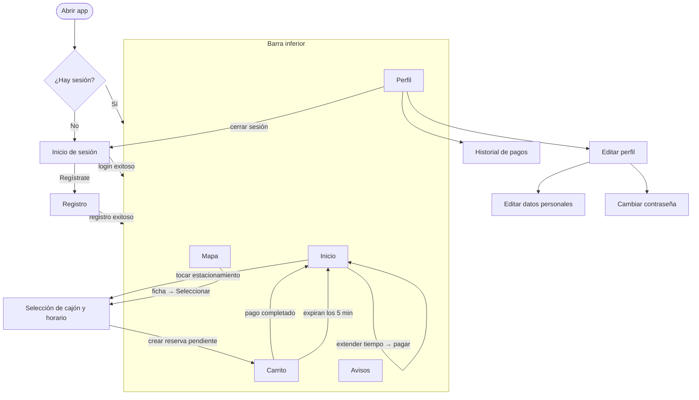

# Navegación y priorización de funcionalidades

## 1. Estructura de navegación

La app tiene una **actividad principal** (`MainActivity`) con una barra de navegación inferior de 5 pestañas. El resto de pantallas se abren encima como actividades independientes.

| Pestaña | Fragmento | Contenido |
|---|---|---|
| **Inicio** | `HomeFragment` | Lista de estacionamientos o, si hay reserva, el estado de la reserva, el escaneo del QR y la extensión de tiempo. |
| **Mapa** | `DiscoverFragment` | Mapa de Google con los estacionamientos; al tocar uno se abre su ficha (`EstacionamientoBottomSheet`). |
| **Carrito** | `ShoppingCartFragment` | Reserva pendiente de pago: temporizador de 5 min, desglose del precio, cupón de descuento y pago con Stripe. |
| **Avisos** | `NotificationsFragment` | Notificaciones y recordatorios (se completa próximamente con FCM). |
| **Perfil** | `ProfileFragment` | Datos del usuario, edición de perfil, historial de pagos y cerrar sesión. |

Pantallas que se abren fuera de la barra:

| Pantalla | Se abre desde |
|---|---|
| `InicioSesion` | Al abrir la app sin sesión, o al cerrar sesión |
| `Registro` | Inicio de sesión → "Regístrate" |
| `SeleccionReservaActivity` | Inicio (tocar un estacionamiento) o Mapa (botón "Seleccionar") |
| `EditarPerfil` | Perfil → "Editar perfil" |
| `EditarDatosPersonales` / `EditarContrasena` | Editar perfil |
| `HistorialActivity` | Perfil → "Historial" |

## 2. Diagrama de navegación

## 3. Pestañas sin reserva activa

**Decisión:** las 5 pestañas se muestran siempre, con o sin reserva. Lo que cambia es el **contenido** de Inicio y Carrito según el estado de la reserva:

| Estado de la reserva | Inicio | Carrito |
|---|---|---|
| Sin reserva | Lista de estacionamientos para reservar | Mensaje "No tienes reservas pendientes" |
| Pendiente de pago | Aviso de reserva pendiente | Temporizador, desglose y botón de pago |
| Confirmada, sin escanear QR | Datos de la reserva y botón para escanear el boleto | Vacío (la reserva ya está pagada) |
| Confirmada, QR escaneado | Datos de la reserva, tiempo restante y extensión de tiempo | Vacío |

**Motivo:** ocultar y mostrar pestañas hace que la barra cambie de tamaño y que los íconos se muevan de lugar, lo que confunde al usuario. Con pestañas fijas y contenido según el estado, el usuario siempre encuentra cada sección en el mismo lugar.

## 4. Reglas de navegación

- Sin sesión, la app siempre abre en **Inicio de sesión**; con sesión, en **Inicio**.
- Al crear una reserva pendiente, la app lleva directo al **Carrito** para pagar.
- Solo se permite **una reserva a la vez**: si ya hay una pendiente o confirmada, Inicio y Mapa no dejan abrir la selección de cajón.
- Al completar el pago o al expirar los 5 minutos, la reserva sale del Carrito y Inicio se actualiza.
- Al cerrar sesión se borran los datos locales y se regresa a Inicio de sesión.

## 5. Funcionalidades priorizadas

La prioridad viene de los resultados del cuestionario a usuarios (issue 1.2).

| Prioridad | Funcionalidad | Pantalla | Respaldo del cuestionario | Requerimiento |
|---|---|---|---|---|
| Alta | Disponibilidad de cajones en tiempo real | Selección de cajón, Mapa | 88.2 % la considera muy importante | RF-01, RF-08 |
| Alta | Reserva anticipada de un cajón | Selección de cajón, Carrito | 82.4 % quiere reservar y recibir notificaciones | RF-03 |
| Alta | Recordatorios del tiempo restante | Avisos, Inicio | 76.5 % los considera muy útiles | RF-05 |
| Alta | Registro e inicio de sesión | Inicio de sesión, Registro | Necesario para reservar y pagar | — |
| Media | Pago digital (Stripe) | Carrito, Inicio (extensión) | 94.1 % prefiere pagar en la app | RF-04 |
| Media | Comisión baja y visible antes de pagar | Carrito | 94.1 % la aceptaría si es baja | RF-06 |
| Media | Historial de pagos | Perfil → Historial | 94.1 % lo considera importante | RF-07 |
| Media | Extensión de tiempo | Inicio | Evita multas y regresar al auto | RF-05 |
| Baja | Tipo de cajón (discapacidad, sección) | Selección de cajón | 64.7 % quiere información completa | RF-01 |
| Baja | Edición de perfil y foto | Perfil → Editar perfil | — | — |
