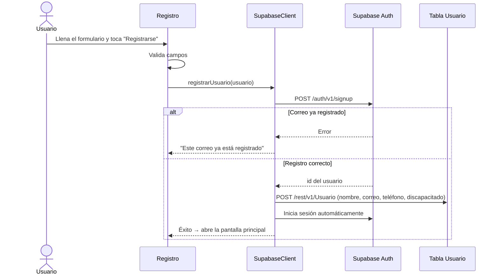
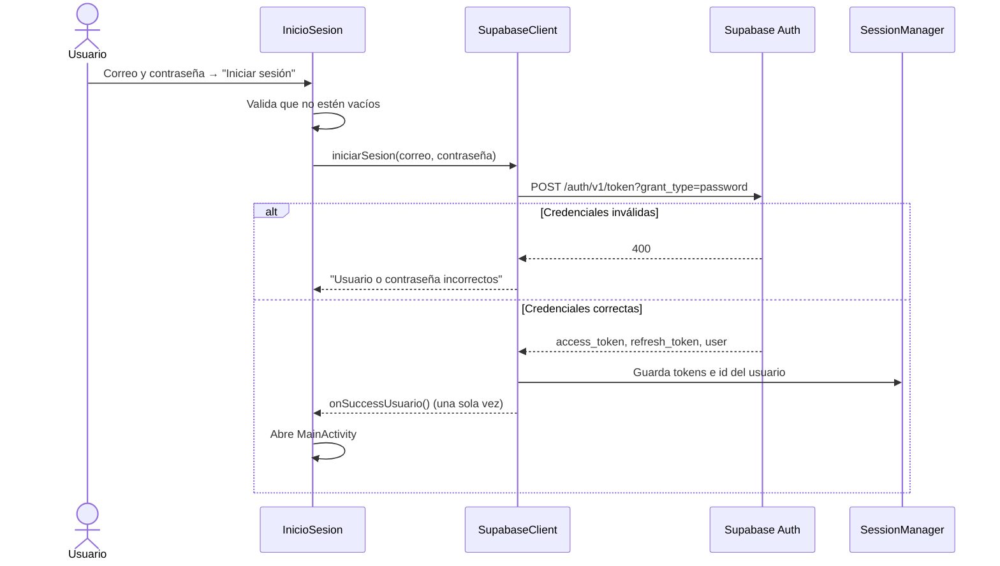

# Registro e inicio de sesión

La autenticación usa **Supabase Auth**. La app no guarda contraseñas: las envía a Supabase, que devuelve un token de acceso (JWT) para usar en las demás peticiones.

## Archivos

| Archivo | Responsabilidad |
|---|---|
| `InicioSesion.java` | Pantalla de inicio de sesión |
| `Registro.java` | Pantalla de registro y validaciones |
| `SupabaseClient.java` | Peticiones a Supabase Auth y a la tabla `Usuario` |
| `SessionManager.java` | Guarda los tokens, los renueva y cierra la sesión |
| `ApiClient.java` | Agrega el token del usuario a todas las peticiones y lo renueva si expiró |

## Registro

### Validaciones

| Validación | Mensaje |
|---|---|
| Algún campo vacío | "Por favor llena todos los campos" |
| Las contraseñas no coinciden | "Las contraseñas no coinciden" |
| Contraseña de menos de 6 caracteres | "La contraseña debe tener al menos 6 caracteres" |
| Discapacidad activada sin folio | "Por favor ingresa tu folio de discapacidad" |
| Folio de discapacidad inválido | "El folio de discapacidad no es válido" |
| Correo ya registrado (lo responde Supabase) | "Este correo ya está registrado" |
| Sin conexión | "Error de conexión" |

## Inicio de sesión

### Manejo de la sesión

- **Tokens guardados:** `access_token`, `refresh_token`, la fecha de expiración y el id del usuario, en `SharedPreferences` a través de `SessionManager`.
- **Renovación automática:** el `access_token` dura 1 hora. Si una petición responde 401, `ApiClient` lo renueva con el `refresh_token` y repite la petición sin que el usuario lo note.
- **Sesión persistente:** si ya hay sesión, la app abre directo en la pantalla principal.
- **Cerrar sesión:** borra los tokens y los datos locales y regresa a Inicio de sesión.

## Criterios de seguridad cumplidos

| Criterio | Cómo se cumple |
|---|---|
| JSON construido con `JsonObject` | `registrarUsuario` e `iniciarSesion` arman el cuerpo con `JsonObject` de Gson. |
| Mensaje ante credenciales inválidas | Respuesta 400 de Supabase → "Usuario o contraseña incorrectos". |
| El callback de éxito se ejecuta una vez | Se llama a la pantalla a `onSuccessUsuario()`. |
| Peticiones como usuario autenticado | Todas las peticiones usan el token del usuario.|
| Cambio de contraseña seguro | `EditarContrasena` verifica la contraseña actual antes de cambiarla. |

## Pendiente

- El folio de discapacidad se valida contra un valor fijo en la app; debería validarse en el servidor.
