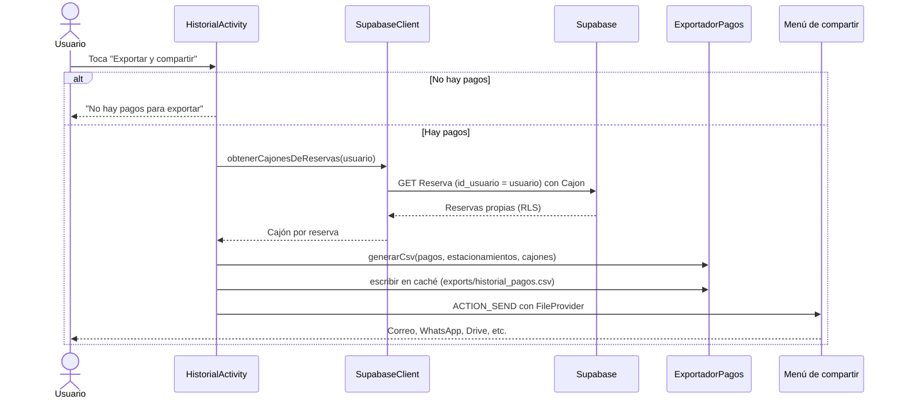

# Exportación del historial de pagos

Desde **Perfil → Historial** el usuario puede exportar sus pagos como un archivo CSV y compartirlo con el menú de Android (correo, WhatsApp, Drive, etc.).

## Formato elegido: CSV

| Opción | Ventaja | Desventaja | Decisión |
|---|---|---|---|
| **CSV** | Abre en Excel, Google Sheets y LibreOffice; es texto plano, fácil de revisar; no requiere librerías | No tiene formato visual | **Elegido** para el historial |
| PDF | Se ve como comprobante, listo para imprimir | Requiere generar el documento con diseño; difícil de procesar en una hoja de cálculo | Pendiente, para un comprobante por pago |

Un PDF por pago (comprobante con el desglose) puede agregarse después como una exportación aparte. El historial completo se entrega en CSV.

## Campos del archivo

| Columna | Origen | Formato | Ejemplo |
|---|---|---|---|
| Fecha | `Pagos.fecha_pago` | `dd/MM/yyyy HH:mm`, hora local | `20/10/2026 12:30` |
| Estacionamiento | `Estacionamiento.nombre` (por `Pagos.id_estacionamiento`) | Texto | `Plaza Ejemplo, Centro` |
| Cajón | `Cajon.seccion` y `Cajon.numero_cajon` (por `Reserva` de `Pagos.id_reserva`) | `Sección X - Cajón Y` | `Sección A - Cajón 12` |
| Tipo | `Pagos.tipo` | `Reserva`, `Extensión de tiempo` o `Pago` si no existe | `Reserva` |
| Subtotal | `Pagos.subtotal` | Dos decimales, sin símbolo | `250.00` |
| Comisión | `Pagos.comision` | Dos decimales, sin símbolo | `10.00` |
| Descuento | `Pagos.descuento` | Dos decimales, sin símbolo | `25.00` |
| Total | `Pagos.monto_total` | Dos decimales, sin símbolo | `235.00` |
| ID de pago | `Pagos.id` | Entero | `101` |

Si un pago es anterior a la migración `20261018_pagos_desglose.sql` (sin subtotal), las columnas Subtotal, Comisión y Descuento se dejan **vacías** en lugar de poner ceros, para no inventar datos.

## Formato técnico

| Característica | Valor | Por qué |
|---|---|---|
| Codificación | UTF-8 con BOM (`EF BB BF` al inicio) | Sin el BOM, Excel muestra mal los acentos (`Comisión`, `Extensión`, `Cajón`) |
| Separador de campos | Coma (`,`) | Estándar de CSV; los campos con comas se encierran entre comillas |
| Fin de línea | CRLF (`\r\n`) | Formato que usa Excel |
| Montos | Punto decimal y dos decimales (`235.00`) | Excel los reconoce como número en cualquier configuración regional |
| Fechas | Hora local de México | Es la hora en la que el usuario hizo el pago |
| Nombre del archivo | `historial_pagos.csv` | Se sobrescribe en cada exportación |

Ejemplo de contenido: [ejemplo_historial_pagos.csv](ejemplo_historial_pagos.csv). Los datos son ficticios.

## Flujo

## Seguridad

- **Solo pagos del usuario con sesión iniciada:** la lista viene de `Pagos` filtrada por `usuario_id` y por la política RLS `pagos_select_propios`. Las reservas para los cajones se leen con `id_usuario` y la política `reserva_select_propias`.
- **Archivo privado:** el CSV se guarda en la caché de la app, que ninguna otra app puede leer. Se comparte con un `FileProvider` (`${applicationId}.fileprovider`) y un permiso de lectura temporal (`FLAG_GRANT_READ_URI_PERMISSION`) solo para la app que el usuario elija.
- **Sin datos de otros usuarios:** el archivo solo contiene los campos listados arriba.

## Archivos

| Archivo | Responsabilidad |
|---|---|
| `pagos/ExportadorPagos.java` | Genera el CSV (escape de campos, BOM, formato de montos y fechas) y lo escribe en caché |
| `pagos/HistorialActivity.java` | Botón de exportar; pide los cajones y abre el menú de compartir |
| `network/SupabaseClient.java` | `obtenerCajonesDeReservas()`: cajón de cada reserva del usuario |
| `res/xml/file_paths.xml` | Declara la carpeta `exports/` de la caché para el `FileProvider` |
| `AndroidManifest.xml` | Registra el `FileProvider` |
| `res/layout/activity_historial.xml` | Botón "Exportar y compartir" |

## Criterios de terminado

| Criterio | Cómo se cumple |
|---|---|
| Formato definido y justificado | CSV, con la justificación de la tabla de arriba. |
| Campos y estructura documentados | Tabla de campos y formato técnico de este documento. |
| Exportar y compartir desde Historial | Botón "Exportar y compartir" con `ACTION_SEND` y menú de compartir. |
| Fechas en hora local, montos con dos decimales, UTF-8 con acentos | `DateTimeUtils.formatearFechaHoraLocal()`, `%.2f` con `Locale.US`, BOM UTF-8. |
| Solo pagos del usuario con sesión | Filtro por `usuario_id` y RLS; las reservas también se filtran por `id_usuario`. |
| Archivo de ejemplo | [ejemplo_historial_pagos.csv](ejemplo_historial_pagos.csv), con datos ficticios. |

## Pendiente

- **Probar en Excel y Google Sheets** con el archivo generado por la app; el ejemplo se verificó con el generador, no con las hojas de cálculo.
- **Comprobante en PDF por pago**, si el equipo lo decide.