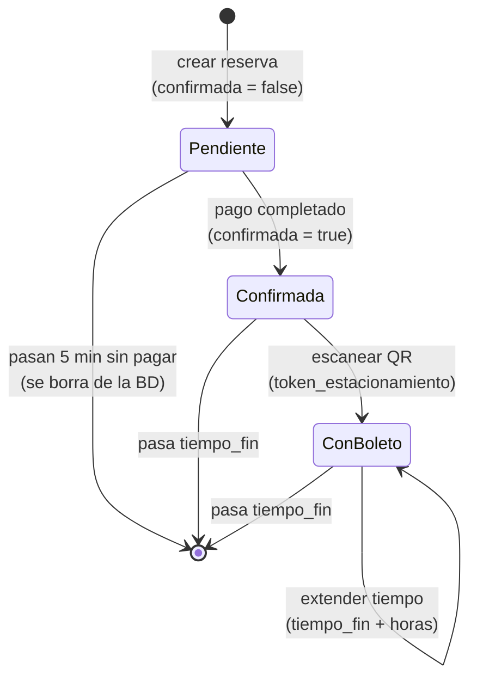
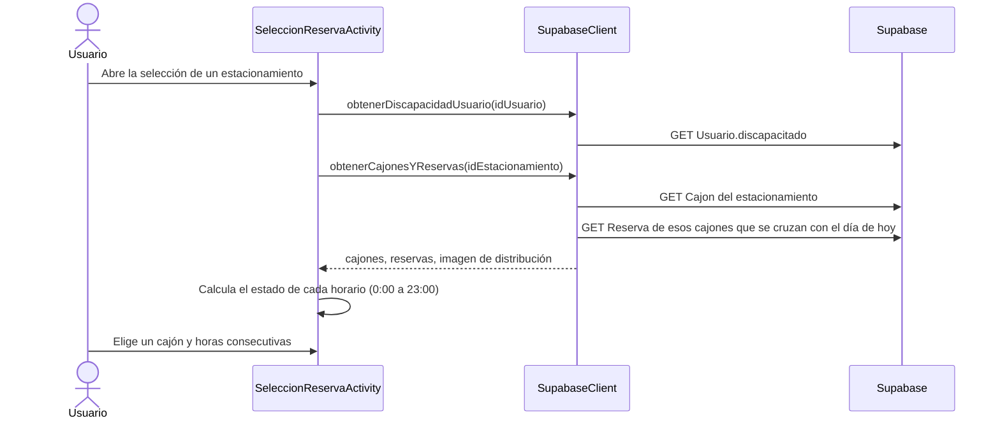
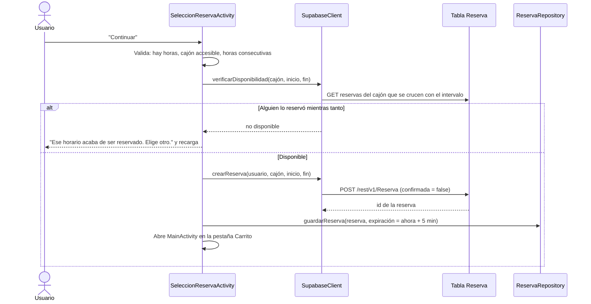
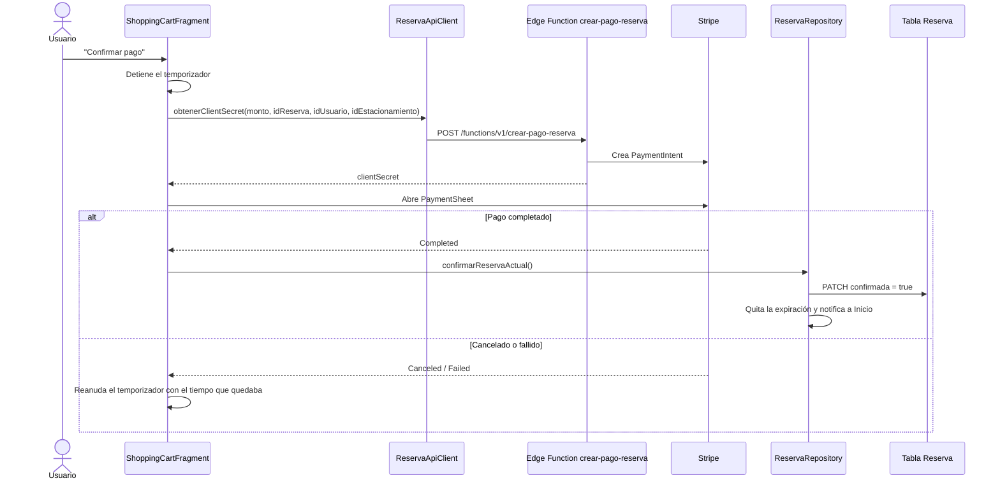
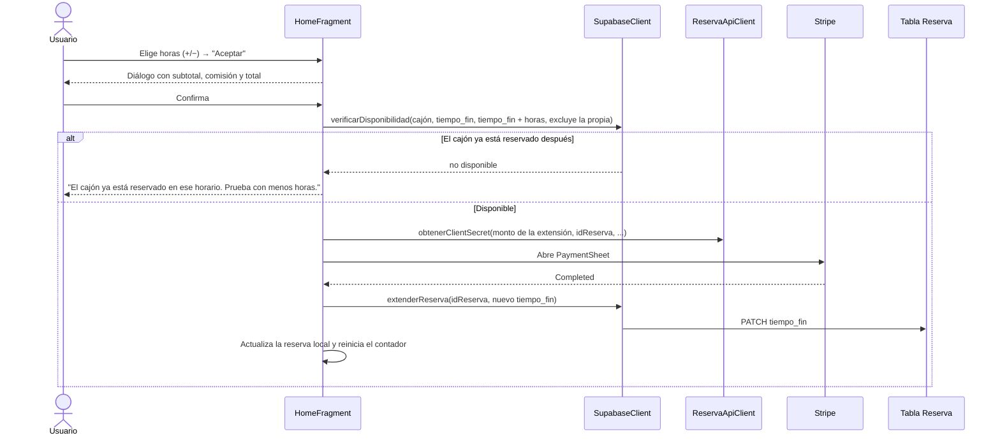

# Flujo de reservas

Una reserva pasa por cuatro etapas: **selección → reserva pendiente → confirmación (pago) → extensión de tiempo**. La reserva se guarda en la tabla `Reserva` de Supabase y, en el teléfono, en `SharedPreferences` para que todas las pantallas compartan el mismo estado.

## Archivos

| Archivo | Responsabilidad |
|---|---|
| `SeleccionReservaActivity.java` | Muestra los cajones y sus horarios del día; crea la reserva pendiente |
| `CajonesAdapter.java` / `HorariosAdapter.java` / `CajonConHorarios.java` | Lista de cajones con sus 24 horarios y el estado de cada uno |
| `ReservaRepository.java` | Fuente única de la reserva activa (`LiveData`); expiración, confirmación y sincronización con el servidor |
| `ReservaActivaPrefs.java` | Guarda la reserva activa en `SharedPreferences` |
| `Reserva.java` | Modelo de la reserva |
| `ShoppingCartFragment.java` | Carrito: temporizador de 5 min, desglose, cupón y pago con Stripe |
| `HomeFragment.java` | Estado de la reserva, escaneo del QR y extensión de tiempo |
| `EstacionamientoBottomSheet.java` | Ficha del estacionamiento en el Mapa; botón "Seleccionar" |
| `SupabaseClient.java` | Peticiones a la tabla `Reserva` |
| `ReservaApiClient.java` | Pide a la Edge Function `crear-pago-reserva` la intención de pago de Stripe |
| `DateTimeUtils.java` | Conversión entre hora local (`America/Mexico_City`) y UTC |

## Estados de una reserva



| Estado | `confirmada` | `token_estacionamiento` | Dónde se muestra |
|---|---|---|---|
| Pendiente | `false` | `null` | Carrito (temporizador y pago); Inicio muestra un aviso |
| Confirmada | `true` | `null` | Inicio: datos de la reserva y botón para escanear el boleto |
| Con boleto | `true` | código del QR | Inicio: datos de la reserva y extensión de tiempo |

Cuando pasa `tiempo_fin`, la reserva confirmada se limpia del teléfono pero **se conserva en la BD** como historial.

## 1. Selección de cajón y horario

Se llega desde **Inicio** (tocar un estacionamiento) o desde el **Mapa** (ficha → "Seleccionar"). Antes de abrir la pantalla, ambos llaman a `ReservaRepository.tieneReservaActiva()`; si ya hay una reserva, muestran "Ya tienes una reserva pendiente de pago" o "Ya tienes una reserva activa" y no abren la selección.



### Estado de cada horario

Cada cajón muestra 24 horarios de una hora. El estado se decide en este orden:

| Estado | Condición |
|---|---|
| `PASADO` | La hora ya pasó |
| `RESTRINGIDO` | El cajón es para personas con discapacidad y el usuario no lo es |
| `OCUPADO` | Alguna reserva del cajón se cruza con ese horario |
| `DISPONIBLE` | Ninguna de las anteriores |

### Solo reservas del día

La consulta de reservas trae únicamente las que se cruzan con el día de hoy (hora local):

```
GET /rest/v1/Reserva
    ?id_cajon=in.(<ids>)
    &tiempo_inicio=lt.<fin del día UTC>
    &tiempo_fin=gt.<inicio del día UTC>
```

Además, `estaReservado()` compara fechas completas (no solo la hora), así una reserva de otro día o una que termina a medianoche no marca horarios equivocados. Por ahora solo se puede reservar para **hoy** (la pantalla muestra "Hoy dd MMM").

## 2. Reserva pendiente

Al tocar "Continuar", `crearReservaPendiente()` valida la selección y crea la reserva.



### Validaciones

| Validación | Mensaje |
|---|---|
| No se eligió ningún horario | "Por favor selecciona al menos un horario" |
| Cajón no accesible para el usuario | "No puedes reservar este cajón" |
| Horas no consecutivas | "Por favor selecciona horas consecutivas" |
| El horario se ocupó justo antes de reservar | "Ese horario acaba de ser reservado. Elige otro." |
| La BD rechaza la reserva por traslape (409) | "Ese horario acaba de ser reservado por otra persona" |
| Ya existe una reserva (desde Inicio o Mapa) | "Ya tienes una reserva pendiente de pago" / "Ya tienes una reserva activa" |

Las horas se convierten de hora local a UTC con `DateTimeUtils.convertirLocalAUTC()` antes de guardarse. La hora de fin es la última hora seleccionada + 1 (por ejemplo, seleccionar 10 y 11 crea una reserva de 10:00 a 12:00).

### Expiración a los 5 minutos

La reserva pendiente tiene 5 minutos para pagarse. Cuando se vencen, `ReservaRepository.limpiarReserva(true)` borra la reserva del teléfono **y la elimina de la BD** (`DELETE /rest/v1/Reserva?id=eq.<id>`), así el cajón vuelve a quedar libre para los demás.

La expiración se revisa en varios momentos, para que se libere aunque el usuario no esté en el Carrito:

| Momento | Dónde |
|---|---|
| El temporizador del Carrito llega a 0 | `ShoppingCartFragment.reservaExpirada()` |
| Se abre la app | `MainActivity` → `verificarExpiracion()` |
| Se vuelve a la pestaña Inicio | `HomeFragment.onResume()` → `verificarExpiracion()` |
| Se intenta abrir la selección de cajón | `tieneReservaActiva()` / `reservaEsPendiente()` |

## 3. Confirmación (pago)

El Carrito muestra la reserva pendiente con el tiempo restante, el desglose y el botón de pago.

| Concepto | Cálculo |
|---|---|
| Subtotal | `precio por hora × horas` |
| Comisión | 4 % del subtotal |
| Descuento | 10 % del subtotal con el cupón `PROMO10` |
| Total | `subtotal + comisión − descuento` |



Tras el pago, la reserva desaparece del Carrito y aparece en **Inicio** con el botón para escanear el boleto. Al llegar al estacionamiento, el usuario escanea el QR y su contenido se guarda en `token_estacionamiento` (`PATCH /rest/v1/Reserva`).

## 4. Extensión de tiempo

La extensión aparece en Inicio solo cuando la reserva está confirmada **y** ya se escaneó el boleto.

| Regla | Valor |
|---|---|
| Horas que se pueden agregar | 1 a 3 por extensión |
| Comisión | 5 % del subtotal |
| Total | `precio por hora × horas + comisión` |



La disponibilidad se revisa **antes** de cobrar, para no cobrar horas que el cajón ya no tiene libres.

## Sincronización con el servidor

Al abrir la app, `MainActivity` llama a `ReservaRepository.sincronizarConServidor()`, que busca la reserva del usuario cuyo `tiempo_fin` aún no pasa:

- Si en el servidor hay una reserva **confirmada** y en el teléfono no (otro teléfono, reinstalación), se recupera.
- Si el `tiempo_fin` cambió en el servidor (extensión desde otro dispositivo), se actualiza en el teléfono.
- Si el teléfono tiene una reserva confirmada que ya no está vigente en el servidor, se limpia.

Las reservas **pendientes no se recuperan**, porque su tiempo para pagar se controla en el teléfono.

## Criterios de terminado

| Criterio | Cómo se cumple |
|---|---|
| Seleccionar cajón y horas consecutivas y crear una reserva pendiente | `SeleccionReservaActivity` valida horas consecutivas y accesibilidad, revisa disponibilidad y crea la reserva con `confirmada = false`. |
| La reserva pendiente expira a los 5 min y se libera en la BD | `limpiarReserva(true)` borra la reserva local y hace `DELETE` en la tabla `Reserva`; la expiración se revisa en el Carrito, al abrir la app y al volver a Inicio. |
| No más de una reserva pendiente, ni desde Inicio ni desde Mapa | `HomeFragment` y `EstacionamientoBottomSheet` llaman a `tieneReservaActiva()` antes de abrir la selección. |
| Solo reservas del día seleccionado al mostrar disponibilidad | La consulta filtra por `tiempo_inicio < fin del día` y `tiempo_fin > inicio del día`; `estaReservado()` compara fechas completas. |
| Flujo documentado | Este documento. |

## Pendiente

- **Expiración desde el servidor:** la reserva pendiente se borra de la BD cuando la app detecta que venció. Si el usuario cierra la app y no la vuelve a abrir, la fila se queda en la BD y el horario aparece ocupado. Se puede resolver con un job programado (`pg_cron`) que borre las reservas con `confirmada = false` y `expiracion < now()`, o filtrando esas filas en las consultas de disponibilidad.
- **Una reserva por usuario en el servidor:** la regla de una sola reserva se valida en el teléfono. Si se reinstala la app con una reserva pendiente, el servidor permitiría crear otra; conviene validarlo con una restricción o política en la BD.
- **Confirmación por webhook:** hoy la app marca `confirmada = true` después del pago; en la fase 2 lo hará el webhook de Stripe en el servidor.
- **Monto calculado en el servidor:** el monto se calcula en la app y se envía a la Edge Function; debería calcularse a partir de la reserva en el servidor.
- **Reservar otros días:** la selección solo permite el día de hoy.
