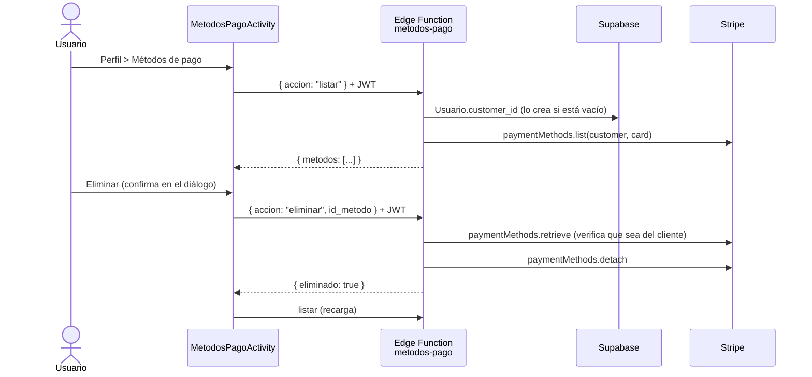

# Métodos de pago (tarjetas guardadas)

Issue relacionado: 7.3 (Flujo general de navegación). Sustituye el aviso "Métodos de Pago (próximamente)" del Perfil por una pantalla real.

El usuario puede ver, agregar y eliminar sus tarjetas guardadas, y elegir una como **predeterminada**. Al pagar una reserva o una extensión de tiempo se usa la predeterminada, y el usuario puede elegir otra de sus tarjetas o pagar con una tarjeta nueva.

Las tarjetas las guarda **Stripe**. Ni la app ni la base de datos reciben el número completo; la app solo recibe la marca, los últimos 4 dígitos y el vencimiento.

## 1. Componentes

| Componente | Ubicación |
|---|---|
| Edge Function | `software/supabase/functions/metodos-pago/index.ts` |
| Cliente HTTP | `src/android_app/.../pagos/MetodosPagoApiClient.java` |
| Pantalla | `src/android_app/.../pagos/MetodosPagoActivity.java` (`res/layout/activity_metodos_pago.xml`) |
| Lista | `pagos/MetodosPagoAdapter.java` (`res/layout/item_metodo_pago.xml`) |
| Modelo | `pagos/MetodoPago.java` |
| Formulario de tarjeta | `pagos/AgregarTarjetaActivity.java` (`res/layout/activity_agregar_tarjeta.xml`) |
| Textos del formulario | `res/values/strings_stripe.xml` y `res/values-es/strings_stripe.xml` |
| Entrada | Perfil, botón **MÉTODOS DE PAGO** (`ui/profile/ProfileFragment.java`), o la fila **PAGO** del Carrito y del diálogo de extensión (modo selección) |

SDK de Stripe en la app: `com.stripe:stripe-android:20.1.0`. Se usan `CardMultilineWidget` (formulario para agregar tarjeta) y `PaymentLauncher` (guardar la tarjeta y pagar con la tarjeta elegida). El PaymentSheet ya no se usa.

## 2. Flujo

### Ver y eliminar tarjetas



### Agregar una tarjeta

1. En Métodos de pago, **Agregar tarjeta** abre `AgregarTarjetaActivity`, que tiene el formulario `CardMultilineWidget` de Stripe:
   - **Número:** solo acepta dígitos y no deja escribir más de los que tiene la marca (16 en Visa y Mastercard, 15 en American Express). Si el número no pasa la validación, el campo se marca en rojo con "El número de tarjeta no es válido."
   - **Vencimiento y CVC:** con sus mensajes de error en español.
   - **Código postal:** obligatorio, exactamente 5 dígitos (`setUsZipCodeRequired(true)`); si está incompleto dice "El código postal debe tener 5 dígitos."
2. Al tocar **Guardar tarjeta**, `validateAllFields()` revisa todos los campos. Si alguno es inválido, no se envía nada.
3. La app pide `preparar_alta`, y la función crea un **SetupIntent** (`usage: off_session`, solo tarjetas).
4. La app confirma el SetupIntent con `PaymentLauncher.confirm(ConfirmSetupIntentParams.create(datosTarjeta, clientSecret))`. Los datos van directo del formulario a Stripe; si la tarjeta pide 3D Secure, Stripe muestra la autenticación.
5. Al terminar (`PaymentResult.Completed`), la pantalla se cierra y Métodos de pago recarga la lista. En modo selección, la tarjeta nueva queda seleccionada.

Los textos del formulario están en `strings_stripe.xml`, en `values/` y en `values-es/`. Sobrescriben los del SDK para que diga "Código postal" (el SDK dice "Código ZIP") y "vencimiento", aunque el teléfono esté en otro idioma.

### Tarjeta predeterminada

- En `MetodosPagoActivity`, la predeterminada lleva la etiqueta **Predeterminada**; las demás tienen el botón **Usar como predeterminada**, que llama a `predeterminar`.
- Se guarda en Stripe, en `customer.invoice_settings.default_payment_method`, así que se conserva aunque el usuario cambie de teléfono.
- Si el usuario tiene tarjetas y ninguna es predeterminada (por ejemplo, la primera que agrega o después de eliminar la predeterminada), `listar` marca la más reciente.

### Elegir el método de pago al pagar

En el Carrito (`ShoppingCartFragment`) y en el diálogo de extensión de tiempo (`HomeFragment`), la fila **PAGO**:

1. Pide `listar` y muestra la tarjeta predeterminada (o la que el usuario eligió para ese pago). El Carrito la recarga cada vez que se vuelve a él.
2. Al tocarla, abre `MetodosPagoActivity` en **modo selección** (`MetodosPagoActivity.intentSeleccion(...)`):
   - título "Elige con qué pagar" y un botón de opción en cada tarjeta; se selecciona tocando la tarjeta;
   - **Pagar con esta tarjeta** devuelve la tarjeta elegida (`EXTRA_ID_METODO`);
   - **Agregar tarjeta** abre el formulario, y al volver queda seleccionada la tarjeta nueva;
   - también se puede eliminar o cambiar la predeterminada.

   La elección vale solo para ese pago; no cambia la predeterminada. Se guarda en el teléfono (`pagos/PreferenciasPago`, junto con el id de la reserva), así que se conserva al cambiar de pestaña o cerrar la app. Se borra al completar el pago o cuando la reserva expira. Si la tarjeta elegida se elimina, se vuelve a usar la predeterminada.

| Caso | Texto en la fila PAGO |
|---|---|
| Mientras carga | `Cargando...` |
| Tarjeta elegida | Por ejemplo `Visa •••• 4242 (vence 12/28)` |
| No tiene tarjetas | `Sin tarjeta guardada` / `Toca para agregar una` |
| Error al consultar | `No se pudo cargar el método de pago` / `Toca para reintentar` |

Al confirmar el pago:

- **Sin tarjeta elegida** (no tiene o no se pudieron cargar): no se crea el pago; se abre Métodos de pago en modo selección con el mensaje "Agrega o elige la tarjeta con la que vas a pagar…".
- **Con tarjeta elegida**: `crear-pago-reserva-v2` crea el PaymentIntent y la app lo confirma con `PaymentLauncher.confirm(ConfirmPaymentIntentParams.createWithPaymentMethodId(idTarjeta, clientSecret))`. Si la tarjeta pide 3D Secure, Stripe muestra la autenticación.

Toda tarjeta nueva entra por `AgregarTarjetaActivity`, así que siempre pasa por la validación del formulario. La acción `llave_cliente` de la función ya no la usa la app; se conserva por compatibilidad.

Stripe solo permite pagar con una tarjeta guardada si el PaymentIntent pertenece al mismo cliente que la tarjeta. `crear-pago-reserva-v2` y `metodos-pago` toman el cliente de `Usuario.customer_id`, así que coinciden.

## 3. Endpoint

`POST https://kjbmwwbzdsvunzndeusf.supabase.co/functions/v1/metodos-pago`

Headers (los agrega `ApiClient`): `apikey` y `Authorization: Bearer <token del usuario>`.

Cuerpo:

| Campo | Tipo | Obligatorio | Descripción |
|---|---|---|---|
| `accion` | string | Sí | `listar`, `preparar_alta`, `llave_cliente`, `eliminar` o `predeterminar` |
| `api_version` | string | Para `preparar_alta` y `llave_cliente` | Versión de la API de Stripe del SDK de Android (en la 20.1.0 es `2020-03-02`). La app la toma de `com.stripe.android.Stripe.API_VERSION` |
| `id_metodo` | string | Para `eliminar` y `predeterminar` | Id del método de pago (`pm_...`) |

La app nunca manda el `customer_id`; la función lo obtiene a partir del JWT.

### Respuestas por acción

| Acción | Respuesta 200 |
|---|---|
| `listar` | `{ "metodos": [ { "id": "pm_...", "marca": "visa", "ultimos4": "4242", "mes_exp": 12, "anio_exp": 2028, "predeterminada": true } ] }` |
| `preparar_alta` | `{ "setupIntentClientSecret": "seti_..._secret_...", "customerId": "cus_...", "ephemeralKey": "ek_test_..." }` |
| `llave_cliente` | `{ "customerId": "cus_...", "ephemeralKey": "ek_test_..." }` |
| `eliminar` | `{ "eliminado": true }` |
| `predeterminar` | `{ "predeterminada": "pm_..." }` |

### Errores

Todos los errores responden `{ "error": "<mensaje>" }`.

| Código | Cuándo |
|---|---|
| 400 | JSON inválido, acción desconocida, `api_version` con formato inválido o `id_metodo` inválido |
| 401 | Falta el token o no es válido |
| 403 | La tarjeta a eliminar o predeterminar no pertenece al cliente del usuario |
| 404 | No existe el usuario en la tabla `Usuario` o no existe la tarjeta |
| 405 | El método HTTP no es `POST` |
| 500 | Error de Stripe o de la base de datos (el detalle solo queda en los logs de la función) |

En la app, `MetodosPagoApiClient` convierte estos códigos en mensajes en español.

## 4. Pantalla

`MetodosPagoActivity` (`activity_metodos_pago.xml`):

- **Lista** de tarjetas: marca, `•••• 1234`, `Vence MM/AA`, etiqueta **Predeterminada** o botón **Usar como predeterminada**, y botón para eliminar.
- **Usar como predeterminada**: guarda la tarjeta como predeterminada en Stripe y recarga la lista.
- **Eliminar**: pide confirmación en un diálogo antes de llamar al servidor.
- **Agregar tarjeta**: abre `AgregarTarjetaActivity` (formulario con validación de número, vencimiento, CVC y código postal de 5 dígitos).
- **Modo selección** (desde el Carrito o la extensión): botón de opción en cada tarjeta y botón **Pagar con esta tarjeta**.
- **Lista vacía**: muestra "No tienes tarjetas guardadas".
- **Carga**: indicador de progreso; los botones se desactivan mientras hay una operación en curso.
- **Error al cargar**: mensaje y botón **Reintentar**.

## 5. Seguridad

- **La tarjeta la guarda Stripe.** La app usa la interfaz de Stripe para capturarla; la función solo devuelve marca, últimos 4 dígitos y vencimiento.
- **La función toma el cliente del JWT.** Obtiene el usuario con `admin.auth.getUser(jwt)` y lee `Usuario.customer_id` con la service role key. Un `customer_id` enviado por la app se ignora.
- **Eliminar y predeterminar verifican al dueño.** Antes del `detach` o del cambio de predeterminada se consulta la tarjeta en Stripe y se compara su `customer` con el del usuario; si no coincide responde 403.
- **Pagar con una tarjeta guardada** solo funciona si la tarjeta es del mismo cliente que el PaymentIntent; Stripe lo valida al confirmar.
- **Cliente de Stripe único.** Si el usuario no tiene `customer_id`, la función crea el cliente (correo, nombre y `metadata.usuario_id`) y lo guarda solo si la columna sigue vacía. Si dos peticiones llegan al mismo tiempo, se conserva el primero y se borra el sobrante.
- **Ephemeral Key de corta duración.** Solo permite a la app leer y administrar los métodos de pago de ese cliente durante unos minutos.
- **Sin llaves en el código.** `STRIPE_SECRET_KEY` es un secreto de las Edge Functions.
- **JWT verificado por Supabase.** La función se despliega con `verify_jwt` activado (el valor por defecto).

## 6. Despliegue de la función

Requisitos: CLI de Supabase con sesión iniciada (`supabase login`) y el proyecto vinculado (`supabase link --project-ref kjbmwwbzdsvunzndeusf`).

1. Verificar que el secreto `STRIPE_SECRET_KEY` ya existe (lo usan las funciones de pago):

   ```bash
   supabase secrets list
   ```

   Si no existe: `supabase secrets set STRIPE_SECRET_KEY=sk_test_...`

2. Desplegar desde la carpeta `software/` **sin** `--no-verify-jwt`:

   ```bash
   cd software
   supabase functions deploy metodos-pago
   ```

3. En el panel de Supabase, **Edge Functions → metodos-pago**, confirmar que **Verify JWT** está activado.
4. Probar desde la app: Perfil → Métodos de pago → Agregar tarjeta con la tarjeta de prueba `4242 4242 4242 4242`, cualquier fecha futura y cualquier CVC.
5. Actualizar el estado de la función en `software/supabase/README.md`.

Si la función se despliega desde el editor del panel de Supabase, pegar el contenido completo de `metodos-pago/index.ts` (no depende de otros archivos).

## 7. Pruebas manuales

| Caso | Resultado esperado |
|---|---|
| Usuario sin tarjetas | "No tienes tarjetas guardadas" |
| Agregar `4242 4242 4242 4242` | La tarjeta aparece en la lista como `Visa •••• 4242` |
| Escribir más de 16 dígitos en una Visa | No deja escribir el dígito 17 |
| Escribir `4242 4242 4242 4241` | El campo se marca en rojo: "El número de tarjeta no es válido." |
| Escribir letras en el número o en el código postal | No se escriben |
| Código postal de 4 dígitos y Guardar | No se guarda: "El código postal debe tener 5 dígitos." |
| Agregar `4000 0025 0000 3155` (pide 3D Secure) | Se completa la autenticación y la tarjeta aparece en la lista |
| Agregar la primera tarjeta | Aparece con la etiqueta **Predeterminada** |
| Tocar **Usar como predeterminada** en otra tarjeta | La etiqueta pasa a esa tarjeta |
| Eliminar una tarjeta y confirmar | Desaparece de la lista; si era la predeterminada, la más reciente pasa a serlo |
| Abrir el Carrito con tarjetas guardadas | La fila PAGO muestra la predeterminada |
| Tocar la fila PAGO | Se abre "Elige con qué pagar" con la tarjeta actual seleccionada |
| Elegir otra tarjeta y tocar "Pagar con esta tarjeta" | La fila muestra la elegida; la predeterminada no cambia |
| Desde "Elige con qué pagar", agregar una tarjeta | Al volver queda seleccionada la nueva |
| Confirmar el pago | Se paga con la tarjeta elegida; el pago aparece en el Historial |
| Confirmar el pago sin tarjetas guardadas | No se cobra; se abre "Elige con qué pagar" para agregar una |
| Pagar con `4000 0025 0000 3155` guardada | Stripe pide la autenticación 3D Secure y luego se completa |
| Extensión de tiempo | El diálogo muestra la predeterminada; al tocarla se abre "Elige con qué pagar" |
| Sin internet al abrir la pantalla | Mensaje de error y botón Reintentar |
