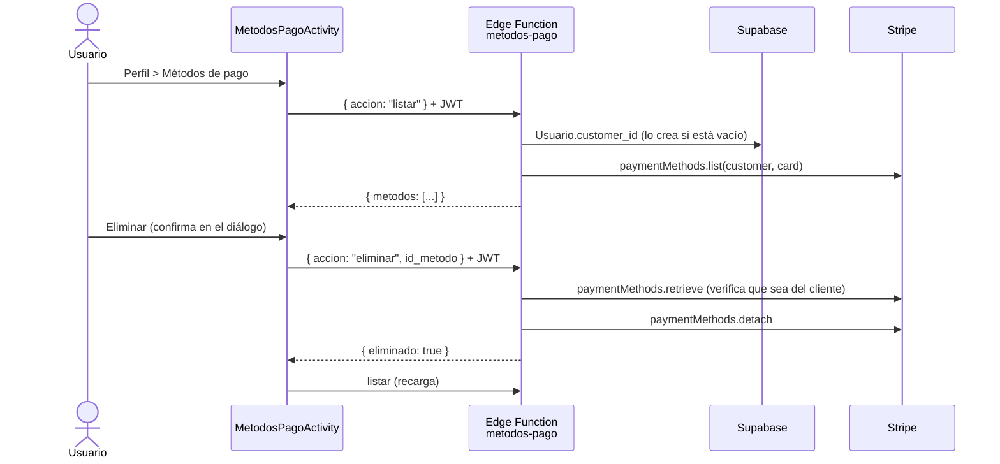

# Métodos de pago (tarjetas guardadas)

Issue relacionado: 7.3 (Flujo general de navegación). Sustituye el aviso "Métodos de Pago (próximamente)" del Perfil por una pantalla real.

El usuario puede ver, agregar y eliminar sus tarjetas guardadas. Al pagar una reserva o una extensión de tiempo, el PaymentSheet de Stripe muestra esas tarjetas para no tener que capturarlas de nuevo.

Las tarjetas las guarda **Stripe**. Ni la app ni la base de datos reciben el número completo; la app solo recibe la marca, los últimos 4 dígitos y el vencimiento.

## 1. Componentes

| Componente | Ubicación |
|---|---|
| Edge Function | `software/supabase/functions/metodos-pago/index.ts` |
| Cliente HTTP | `src/android_app/.../pagos/MetodosPagoApiClient.java` |
| Pantalla | `src/android_app/.../pagos/MetodosPagoActivity.java` (`res/layout/activity_metodos_pago.xml`) |
| Lista | `pagos/MetodosPagoAdapter.java` (`res/layout/item_metodo_pago.xml`) |
| Modelo | `pagos/MetodoPago.java` |
| Entrada | Perfil, botón **MÉTODOS DE PAGO** (`ui/profile/ProfileFragment.java`) |

SDK de Stripe en la app: `com.stripe:stripe-android:20.1.0` (PaymentSheet).

## 2. Flujo

### Ver y eliminar tarjetas



### Agregar una tarjeta

1. La app pide `preparar_alta`.
2. La función crea un **SetupIntent** (`usage: off_session`, solo tarjetas) y una **Ephemeral Key** del cliente.
3. La app abre `PaymentSheet.presentWithSetupIntent` con `PaymentSheet.CustomerConfiguration(customerId, ephemeralKey)`.
4. El usuario captura la tarjeta en la interfaz de Stripe. Stripe la guarda en el cliente.
5. Al terminar (`PaymentSheetResult.Completed`), la app recarga la lista.

### Usar las tarjetas guardadas al pagar

En el carrito (`ShoppingCartFragment`) y en la extensión de tiempo (`HomeFragment`), justo antes de abrir el PaymentSheet:

1. La app pide `llave_cliente`.
2. Si el `customerId` que devuelve es el mismo que devolvió `crear-pago-reserva-v2` para el PaymentIntent, se agrega `CustomerConfiguration` y el PaymentSheet muestra las tarjetas guardadas.
3. Si la llamada falla o los clientes no coinciden, el PaymentSheet se abre igual que antes, sin tarjetas guardadas. El pago no se bloquea.

El paso 2 compara los clientes porque Stripe solo permite pagar con una tarjeta guardada si el PaymentIntent pertenece al mismo cliente que la tarjeta.

### Método de pago en el Carrito

Al mostrar una reserva pendiente, y cada vez que se vuelve al Carrito, `ShoppingCartFragment` pide `listar` y muestra en la fila **PAGO**:

| Caso | Texto |
|---|---|
| Mientras carga | `Cargando...` |
| Tiene tarjetas | La más reciente, por ejemplo `Visa •••• 4242  (vence 12/28)`; si tiene más, agrega `+N tarjeta(s) más` |
| No tiene tarjetas | `Sin método de pago guardado` |
| Error al consultar | `No se pudo cargar el método de pago` |

Es solo informativo: al confirmar, el usuario elige la tarjeta (guardada o nueva) en el PaymentSheet.

Al tocar la fila **PAGO** se abre `MetodosPagoActivity`; al volver, el Carrito recarga la tarjeta mostrada.

## 3. Endpoint

`POST https://kjbmwwbzdsvunzndeusf.supabase.co/functions/v1/metodos-pago`

Headers (los agrega `ApiClient`): `apikey` y `Authorization: Bearer <token del usuario>`.

Cuerpo:

| Campo | Tipo | Obligatorio | Descripción |
|---|---|---|---|
| `accion` | string | Sí | `listar`, `preparar_alta`, `llave_cliente` o `eliminar` |
| `api_version` | string | Para `preparar_alta` y `llave_cliente` | Versión de la API de Stripe del SDK de Android (en la 20.1.0 es `2020-03-02`). La app la toma de `com.stripe.android.Stripe.API_VERSION` |
| `id_metodo` | string | Para `eliminar` | Id del método de pago (`pm_...`) |

La app nunca manda el `customer_id`; la función lo obtiene a partir del JWT.

### Respuestas por acción

| Acción | Respuesta 200 |
|---|---|
| `listar` | `{ "metodos": [ { "id": "pm_...", "marca": "visa", "ultimos4": "4242", "mes_exp": 12, "anio_exp": 2028 } ] }` |
| `preparar_alta` | `{ "setupIntentClientSecret": "seti_..._secret_...", "customerId": "cus_...", "ephemeralKey": "ek_test_..." }` |
| `llave_cliente` | `{ "customerId": "cus_...", "ephemeralKey": "ek_test_..." }` |
| `eliminar` | `{ "eliminado": true }` |

### Errores

Todos los errores responden `{ "error": "<mensaje>" }`.

| Código | Cuándo |
|---|---|
| 400 | JSON inválido, acción desconocida, `api_version` con formato inválido o `id_metodo` inválido |
| 401 | Falta el token o no es válido |
| 403 | La tarjeta a eliminar no pertenece al cliente del usuario |
| 404 | No existe el usuario en la tabla `Usuario` o no existe la tarjeta |
| 405 | El método HTTP no es `POST` |
| 500 | Error de Stripe o de la base de datos (el detalle solo queda en los logs de la función) |

En la app, `MetodosPagoApiClient` convierte estos códigos en mensajes en español.

## 4. Pantalla

`MetodosPagoActivity` (`activity_metodos_pago.xml`):

- **Lista** de tarjetas: marca, `•••• 1234`, `Vence MM/AA` y botón para eliminar.
- **Eliminar**: pide confirmación en un diálogo antes de llamar al servidor.
- **Agregar tarjeta**: abre el PaymentSheet de Stripe.
- **Lista vacía**: muestra "No tienes tarjetas guardadas".
- **Carga**: indicador de progreso; los botones se desactivan mientras hay una operación en curso.
- **Error al cargar**: mensaje y botón **Reintentar**.

## 5. Seguridad

- **La tarjeta la guarda Stripe.** La app usa la interfaz de Stripe para capturarla; la función solo devuelve marca, últimos 4 dígitos y vencimiento.
- **La función toma el cliente del JWT.** Obtiene el usuario con `admin.auth.getUser(jwt)` y lee `Usuario.customer_id` con la service role key. Un `customer_id` enviado por la app se ignora.
- **Eliminar verifica al dueño.** Antes del `detach` se consulta la tarjeta en Stripe y se compara su `customer` con el del usuario; si no coincide responde 403.
- **Cliente de Stripe único.** Si el usuario no tiene `customer_id`, la función crea el cliente (correo, nombre y `metadata.usuario_id`) y lo guarda solo si la columna sigue vacía. Si dos peticiones llegan al mismo tiempo, se conserva el primero y se borra el sobrante.
- **Ephemeral Key de corta duración.** Solo permite a la app leer y administrar los métodos de pago de ese cliente durante unos minutos.
- **Sin llaves en el código.** `STRIPE_SECRET_KEY` es un secreto de las Edge Functions.
- **JWT verificado por Supabase.** La función se despliega con `verify_jwt` activado (el valor por defecto).

## 6. Despliegue de la función

Requisitos: CLI de Supabase con sesión iniciada (`supabase login`) y el proyecto vinculado (`supabase link --project-ref kjbmwwbzdsvunzndeusf`).

1. Verificar que el secreto `STRIPE_SECRET_KEY` ya existe (lo usan las funciones de pago):

   ```bash
   supabase secrets list
   ```

   Si no existe: `supabase secrets set STRIPE_SECRET_KEY=sk_test_...`

2. Desplegar desde la carpeta `software/` **sin** `--no-verify-jwt`:

   ```bash
   cd software
   supabase functions deploy metodos-pago
   ```

3. En el panel de Supabase, **Edge Functions → metodos-pago**, confirmar que **Verify JWT** está activado.
4. Probar desde la app: Perfil → Métodos de pago → Agregar tarjeta con la tarjeta de prueba `4242 4242 4242 4242`, cualquier fecha futura y cualquier CVC.
5. Actualizar el estado de la función en `software/supabase/README.md`.

## 7. Pruebas manuales

| Caso | Resultado esperado |
|---|---|
| Usuario sin tarjetas | "No tienes tarjetas guardadas" |
| Agregar `4242 4242 4242 4242` | La tarjeta aparece en la lista como `Visa •••• 4242` |
| Agregar `4000 0025 0000 3155` (pide 3D Secure) | Se completa la autenticación y la tarjeta aparece en la lista |
| Eliminar una tarjeta y confirmar | Desaparece de la lista |
| Pagar una reserva con tarjetas guardadas | El PaymentSheet las muestra y el pago se completa |
| Sin internet al abrir la pantalla | Mensaje de error y botón Reintentar |
| Función no desplegada al pagar | El pago funciona igual que antes, sin tarjetas guardadas |
