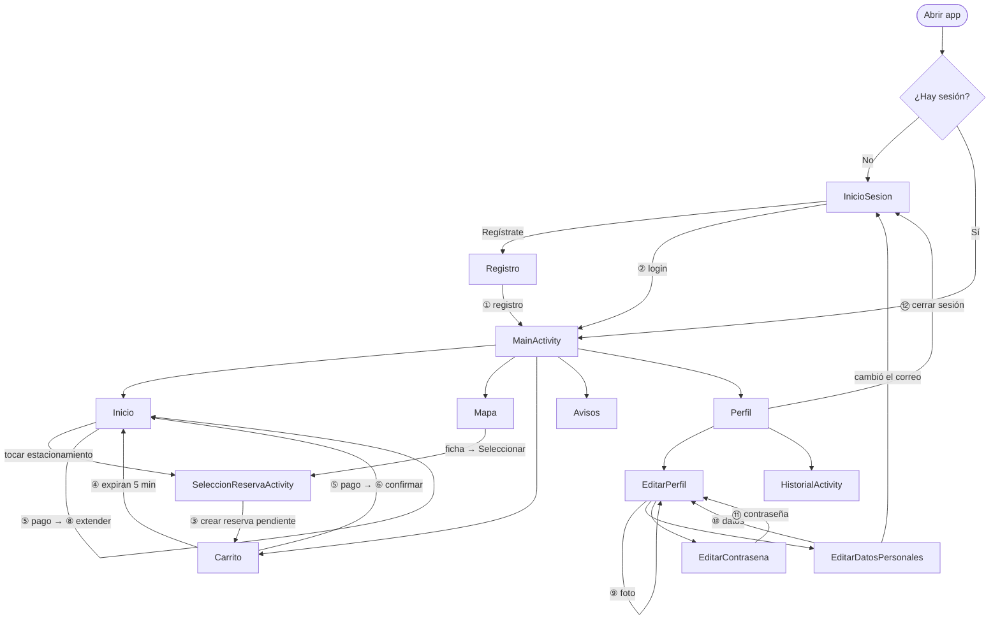
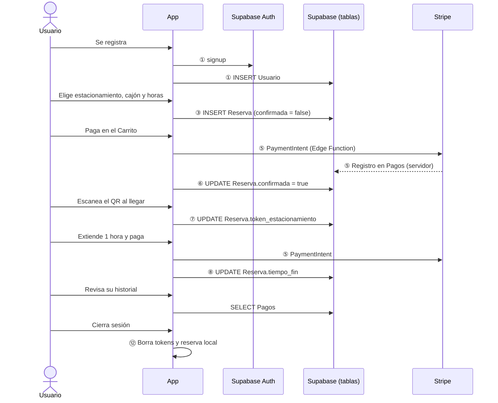

# Flujo general de navegación y trazabilidad

Este documento une los módulos de la app (sesión, estacionamientos, reservas, pagos y perfil) en un solo recorrido e identifica en qué puntos se registra información del usuario. La estructura de pestañas y las reglas de navegación están en [Navegación y priorización](Navegacion%20y%20priorizacion.md); el detalle de cada módulo, en [Registro e inicio de sesión](Registro%20e%20inicio%20de%20sesion.md) y [Flujo de reservas](Flujo%20de%20reservas.md).

## 1. Recorrido completo

Los números (①…⑫) corresponden a los puntos de registro de la sección 3.

### Cómo se llega a cada pantalla y cómo se sale

| Pantalla | Se llega desde | Se sale con |
|---|---|---|
| `InicioSesion` | Abrir la app sin sesión, cerrar sesión, cambiar el correo | Login exitoso → `MainActivity` (limpia la pila) |
| `Registro` | Inicio de sesión → "Regístrate" | Registro exitoso → `MainActivity` (limpia la pila); atrás → Inicio de sesión |
| `MainActivity` (5 pestañas) | Login, registro o abrir la app con sesión | Barra inferior entre pestañas |
| `SeleccionReservaActivity` | Inicio o Mapa, solo si no hay reserva activa | Reserva creada → Carrito; atrás → pestaña anterior |
| `EditarPerfil` | Perfil → "Editar perfil" | Atrás → Perfil (recarga foto y nombre) |
| `EditarDatosPersonales` | Editar perfil | Guardar → Editar perfil; si cambió el correo → Inicio de sesión |
| `EditarContrasena` | Editar perfil | Guardar → Editar perfil |
| `HistorialActivity` | Perfil → "Historial" | Atrás → Perfil |

### Navegación entre módulos

| De → a | Mecanismo |
|---|---|
| Sesión → app | `MainActivity.onCreate()` revisa `SessionManager.haySesion()`; sin sesión abre `InicioSesion`. |
| Selección → Carrito | `SeleccionReservaActivity` abre `MainActivity` con el extra `navigate_to = "shoppingcart"`; `manejarNavegacion()` cambia de pestaña. |
| Carrito ↔ Inicio | No hay navegación directa: ambos observan el mismo `LiveData` de `ReservaRepository`, así que al pagar o expirar la reserva las dos pestañas se actualizan solas. |
| Cualquier pantalla → Inicio de sesión | Cerrar sesión o cambiar el correo abre `InicioSesion` con `FLAG_ACTIVITY_CLEAR_TASK`, para que "atrás" no regrese a pantallas de la sesión anterior. |

## 2. Diagrama del recorrido de un usuario

Recorrido de punta a punta de un usuario nuevo, usado como guion para la evidencia en video:

## 3. Puntos de registro (trazabilidad)

Cada punto en el que la app crea o cambia información del usuario, dónde se guarda y qué lo dispara.

| # | Evento | Pantalla / clase | Petición | Dónde queda registrado |
|---|---|---|---|---|
| ① | Registro | `Registro` → `SupabaseClient.registrarUsuario()` | `POST /auth/v1/signup` y `POST /rest/v1/Usuario` | Cuenta en Supabase Auth; fila en `Usuario` (nombre, correo, teléfono, discapacitado) |
| ② | Inicio de sesión | `InicioSesion` → `SupabaseClient.iniciarSesion()` | `POST /auth/v1/token?grant_type=password` | Supabase Auth registra el último inicio de sesión; en el teléfono, tokens e id en `SessionManager` |
| ② | Renovación del token | `ApiClient` / `SessionManager` | `POST /auth/v1/token?grant_type=refresh_token` | Nuevo `access_token` en el teléfono |
| ③ | Reserva creada | `SeleccionReservaActivity` → `crearReserva()` | `POST /rest/v1/Reserva` | Fila en `Reserva` con `confirmada = false`, `created_at` y `expiracion`; copia local en `ReservaActivaPrefs` |
| ④ | Reserva pendiente expirada | `ReservaRepository.limpiarReserva(true)` | `DELETE /rest/v1/Reserva?id=eq.<id>` | La fila se borra (no queda rastro de la reserva no pagada) |
| ⑤ | Pago (reserva o extensión) | `ShoppingCartFragment` / `HomeFragment` → `ReservaApiClient` | `POST /functions/v1/crear-pago-reserva` | PaymentIntent en Stripe; fila en `Pagos` escrita del lado del servidor (la app no inserta en `Pagos`) |
| ⑥ | Reserva confirmada | `ReservaRepository.confirmarReservaActual()` | `PATCH /rest/v1/Reserva` (`confirmada = true`) | Cambio de estado en `Reserva` |
| ⑦ | Boleto escaneado | `HomeFragment.guardarTokenEstacionamiento()` | `PATCH /rest/v1/Reserva` (`token_estacionamiento`) | Código del QR en `Reserva`; prueba de que el usuario llegó |
| ⑧ | Tiempo extendido | `HomeFragment.procesarExtensionDespuesDePago()` | `PATCH /rest/v1/Reserva` (`tiempo_fin`) | Nuevo `tiempo_fin` en `Reserva` |
| ⑨ | Foto de perfil | `EditarPerfil` | `POST /storage/v1/object/<bucket>/<id>.jpg` y `PATCH /rest/v1/Usuario` | Imagen en Supabase Storage; `Usuario.url_foto_perfil` |
| ⑩ | Datos personales | `EditarDatosPersonales` | `PATCH /rest/v1/Usuario` y, si cambia el correo, `PUT /auth/v1/user` | `Usuario` (nombre, correo, teléfono, discapacitado); correo en Supabase Auth |
| ⑪ | Contraseña | `EditarContrasena` | Verifica con `POST /auth/v1/token` y cambia con `PUT /auth/v1/user` | Solo en Supabase Auth |
| ⑫ | Cierre de sesión | `ProfileViewModel.cerrarSesion()` | — (solo local) | Borra tokens, datos de sesión y la reserva local; la reserva en la BD no se toca |

### Cambios de estado de la reserva

| Estado | Evento que lo produce | Campo que cambia |
|---|---|---|
| Pendiente | ③ Reserva creada | `confirmada = false`, `expiracion = now() + 5 min` |
| Eliminada | ④ Pasan 5 min sin pagar | Se borra la fila |
| Confirmada | ⑥ Pago completado | `confirmada = true` |
| Con boleto | ⑦ QR escaneado | `token_estacionamiento` |
| Extendida | ⑧ Pago de extensión | `tiempo_fin` |
| Terminada | Pasa `tiempo_fin` | Ninguno: se limpia del teléfono y la fila queda como historial |

### Qué se puede reconstruir con lo registrado

- **Quién reservó qué y cuándo:** `Reserva.id_usuario`, `id_cajon`, `tiempo_inicio`, `tiempo_fin`, `created_at`.
- **Si llegó al estacionamiento:** `Reserva.token_estacionamiento` no nulo.
- **Cuánto pagó:** filas de `Pagos` con `usuario_id` e `id_reserva` (pago inicial y extensiones).

No se puede reconstruir:

- **El historial de cambios de una reserva:** las extensiones sobrescriben `tiempo_fin`, así que no se sabe el horario original ni cuándo se extendió (solo que hubo varios pagos para la misma reserva).
- **Las reservas que expiraron sin pagarse:** se borran de la BD.
- **Los cierres de sesión:** solo ocurren en el teléfono.

## 4. Revisión de pantallas muertas y placeholders

Revisión de cada pantalla contra el criterio de terminado ("se puede recorrer la app completa sin pantallas muertas ni placeholders"):

| Pantalla / elemento | Estado | Observación |
|---|---|---|
| Inicio de sesión, Registro | Completa | |
| Inicio (4 estados de reserva) | Completa | |
| Mapa y ficha del estacionamiento | Completa | |
| Selección de cajón y horario | Completa | |
| Carrito | Completa con un dato fijo | El método de pago muestra un texto fijo "Visa \*\*\*\* \*\*\*\* \*\*\*\* 1234"; el método real se elige en el PaymentSheet de Stripe. |
| **Avisos** | **Placeholder** | `NotificationsViewModel` muestra el texto de plantilla "This is notifications fragment". Pendiente de FCM. |
| Perfil | Completa salvo un botón | |
| **Perfil → "Métodos de pago"** | **Placeholder** | Solo muestra el aviso "Métodos de Pago (próximamente)". |
| Editar perfil, datos personales, contraseña | Completa | |
| Historial | Completa | Muestra "No tienes pagos registrados" si está vacío. |
| Imágenes de estacionamientos sin foto | Dependencia externa | Si no hay foto, se usa `via.placeholder.com`, un servicio externo que puede no responder; conviene usar un recurso local. |
| Layouts sin usar | No accesibles | `activity_detalle_mes.xml`, `perfil_activity.xml` y `home.xml` no los usa ninguna clase; se pueden borrar. |

**Resultado:** el recorrido principal (registro → reserva → pago → QR → extensión → historial → cerrar sesión) no tiene pantallas muertas. Para cumplir el criterio completo falta resolver la pestaña **Avisos** y el botón **Métodos de pago**.

## Pendiente

- **Avisos:** reemplazar el texto de plantilla, aunque sea con un estado vacío ("No tienes avisos"), hasta integrar FCM.
- **Métodos de pago:** ocultar el botón u ofrecer una pantalla real; Stripe ya permite elegir la tarjeta al pagar.
- **Método de pago fijo en el Carrito:** quitar el texto "Visa … 1234" o mostrar el método real.
- **Historial de cambios de la reserva:** guardar las extensiones (por ejemplo, en `Pagos.metadata` o en una tabla de eventos) para no perder el horario original.