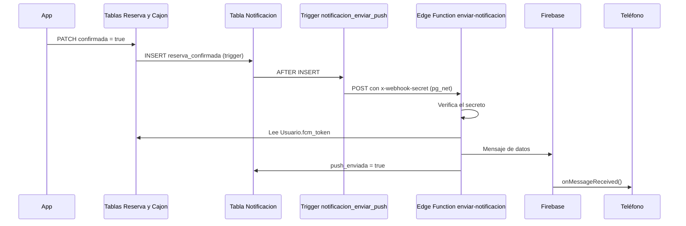

# Notificaciones en Supabase (SQL y Edge Functions)

Todo lo que se añadió en Supabase para las notificaciones push: columnas, tabla, triggers, tarea programada y Edge Functions. El lado de la app está en [Notificaciones](Notificaciones.md).

Última revisión: 06/11/2026.

## 1. Resumen de lo añadido

| Elemento | Tipo | Archivo |
|---|---|---|
| `Usuario.fcm_token`, `Usuario.bienvenida_enviada` | Columnas | `supabase/migrations/20261105_fcm_token.sql` |
| `Notificacion` | Tabla, índices y RLS | `supabase/migrations/20261106_notificaciones_eventos.sql` |
| `reserva_notificar_cambios()` y trigger `reserva_notificar` | Función y trigger en `Reserva` | `20261106_notificaciones_eventos.sql` |
| `cajon_notificar_cambio_estado()` y trigger `cajon_estado_notificar` | Función y trigger en `Cajon` | `20261106_notificaciones_eventos.sql` |
| `notificar_reservas_por_terminar()` y job `recordatorios-fin-reserva` | Función y tarea de `pg_cron` | `20261106_notificaciones_eventos.sql` |
| `notificacion_enviar_push` | Trigger en `Notificacion` que llama a la Edge Function | `supabase/migrations/20261106_notificaciones_webhook.sql` |
| `notificar-bienvenida` | Edge Function | `supabase/functions/notificar-bienvenida/index.ts` |
| `enviar-notificacion` | Edge Function | `supabase/functions/enviar-notificacion/index.ts` |

El código de envío a FCM está incluido en cada `index.ts`, de modo que cada función se puede crear en el editor del panel como un solo archivo.

## 2. Flujo de un aviso



Los eventos de `Cajon` y el recordatorio de `pg_cron` siguen el mismo camino desde la fila insertada en `Notificacion`. El push se manda **después** de confirmar la transacción: `pg_net` lo envía en segundo plano y un fallo del envío nunca revierte la reserva ni el cambio de estado del cajón.

## 3. Base de datos

### 3.1 Columnas nuevas en `Usuario`

| Campo | Tipo | Nulo | Por defecto | Descripción |
|---|---|---|---|---|
| `fcm_token` | `text` | Sí | — | Token de FCM del teléfono con la sesión abierta. Se borra al cerrar sesión |
| `bienvenida_enviada` | `boolean` | No | `false` | Evita mandar la bienvenida más de una vez. Los usuarios que ya existían se marcaron como `true` |

La política RLS existente de `Usuario` (`auth.uid() = id`) ya protege ambas columnas.

### 3.2 Tabla `Notificacion`

Historial de avisos de cada usuario y bandeja de salida de los pushes.

```sql
CREATE TABLE IF NOT EXISTS "Notificacion" (
  id           bigint GENERATED ALWAYS AS IDENTITY PRIMARY KEY,
  id_usuario   uuid   NOT NULL REFERENCES "Usuario"(id) ON DELETE CASCADE,
  id_reserva   bigint REFERENCES "Reserva"(id) ON DELETE SET NULL,
  tipo         text   NOT NULL,
  titulo       text   NOT NULL,
  mensaje      text   NOT NULL,
  leida        boolean     NOT NULL DEFAULT false,
  push_enviada boolean     NOT NULL DEFAULT false,
  created_at   timestamptz NOT NULL DEFAULT now()
);
```

| Campo | Tipo | Nulo | Por defecto | Llave | Descripción |
|---|---|---|---|---|---|
| `id` | `bigint` (identity) | No | Autoincremental | PK | Identificador del aviso |
| `id_usuario` | `uuid` | No | — | FK → `Usuario.id` | Usuario que recibe el aviso |
| `id_reserva` | `bigint` | Sí | — | FK → `Reserva.id` | Reserva que originó el aviso, si aplica |
| `tipo` | `text` | No | — | | `reserva_confirmada`, `reserva_extendida`, `recordatorio_fin`, `cajon_reservado`, `cajon_ocupado` o `cajon_desocupado` |
| `titulo` | `text` | No | — | | Título de la notificación |
| `mensaje` | `text` | No | — | | Texto de la notificación |
| `leida` | `boolean` | No | `false` | | Reservado para marcar avisos leídos (aún no se usa) |
| `push_enviada` | `boolean` | No | `false` | | `true` cuando FCM aceptó el mensaje. Sirve para diagnosticar |
| `created_at` | `timestamptz` | No | `now()` | | Fecha del aviso (UTC) |

Índices:

| Índice | Columnas | Para qué |
|---|---|---|
| `notificacion_usuario_fecha_idx` | `(id_usuario, created_at DESC)` | Listar los avisos de un usuario en la pestaña Avisos |
| `notificacion_reserva_tipo_idx` | `(id_reserva, tipo)` | Consultar si una reserva ya tiene un aviso de cierto tipo (recordatorio y antirrebote) |

### 3.3 Relaciones

| Tabla (hija) | Campo | Referencia (padre) | ON DELETE |
|---|---|---|---|
| `Notificacion` | `id_usuario` | `Usuario.id` | CASCADE |
| `Notificacion` | `id_reserva` | `Reserva.id` | SET NULL |

Al borrar un usuario se borran sus avisos. Al borrar una reserva (por ejemplo, una pendiente que expiró) el aviso se conserva y solo pierde la referencia.

### 3.4 Seguridad (RLS)

`Notificacion` tiene RLS activado:

| Operación | Política | Quién |
|---|---|---|
| SELECT | `notificacion_select_propias`: `auth.uid() = id_usuario` | Usuario autenticado, solo sus avisos |
| INSERT / UPDATE / DELETE | Ninguna | Solo los triggers (`SECURITY DEFINER`) y la llave `service_role` de las Edge Functions |

La app nunca inserta avisos: no puede crear notificaciones falsas ni modificar el texto de las existentes.

## 4. Triggers y funciones SQL

Las tres funciones se ejecutan con `SECURITY DEFINER` y `SET search_path = public`, porque quien actualiza `Reserva` o `Cajon` (la app o el gateway) no tiene permiso de insertar en `Notificacion`. Además atrapan sus propios errores (`EXCEPTION WHEN OTHERS`, que solo deja un `WARNING`): una falla al notificar nunca debe impedir confirmar una reserva ni actualizar un cajón.

Las horas de los mensajes se convierten a `America/Mexico_City`. El lugar se escribe como sección y número (por ejemplo, `A4`).

### 4.1 Pago y reserva (`Reserva`)

```sql
CREATE TRIGGER reserva_notificar
  AFTER UPDATE OF confirmada, tiempo_fin ON "Reserva"
  FOR EACH ROW
  WHEN (OLD.confirmada IS DISTINCT FROM NEW.confirmada
        OR OLD.tiempo_fin IS DISTINCT FROM NEW.tiempo_fin)
  EXECUTE FUNCTION reserva_notificar_cambios();
```

| Condición | `tipo` | Título | Mensaje |
|---|---|---|---|
| `confirmada` pasa de `false` a `true` | `reserva_confirmada` | Pago recibido, reserva confirmada | Tu reserva en *estacionamiento*, lugar *A4*, de *HH:MM* a *HH:MM* está confirmada. |
| La reserva ya estaba confirmada y `tiempo_fin` aumenta | `reserva_extendida` | Tiempo extendido | Pago recibido. Tu reserva en *estacionamiento* (lugar *A4*) ahora termina a las *HH:MM*. |

Se dispara cuando la fila cambia, sin importar quién la cambie: hoy la app (`PATCH confirmada` y `PATCH tiempo_fin`) y, cuando se implemente, el webhook de Stripe.

### 4.2 Estado del cajón (`Cajon`)

```sql
CREATE TRIGGER cajon_estado_notificar
  AFTER UPDATE OF estado_cajon ON "Cajon"
  FOR EACH ROW
  WHEN (OLD.estado_cajon IS DISTINCT FROM NEW.estado_cajon)
  EXECUTE FUNCTION cajon_notificar_cambio_estado();
```

El gateway de la Raspberry Pi actualiza `estado_cajon` (`0` libre, `1` ocupado, `2` reservado). Se avisa al usuario cuya **reserva confirmada está en curso** en ese cajón (`tiempo_inicio <= now() < tiempo_fin`); si no hay ninguna, no se crea nada.

| Cambio | Condición | `tipo` | Título | Mensaje |
|---|---|---|---|---|
| `0 → 2` | | `cajon_reservado` | Tu reserva comenzó | El cajón *A4* en *estacionamiento* está apartado para ti hasta las *HH:MM*. |
| `1 → 2` | | `cajon_desocupado` | Tu cajón quedó vacío | El cajón *A4* ya no tiene vehículo. Tu reserva sigue vigente hasta las *HH:MM*. |
| `→ 1` | Ya escaneó el QR (`token_estacionamiento` no nulo) | `cajon_ocupado` | Vehículo detectado | Se detectó tu vehículo en el cajón *A4*. |
| `→ 1` | Aún no escaneó el QR | `cajon_ocupado` | Vehículo detectado en tu cajón | Se detectó un vehículo en el cajón *A4*. Si eres tú, escanea el boleto en la app para confirmar tu llegada; si no, avisa al personal. |

Reglas:

- **No se avisa el paso a `0` (libre):** con una reserva en curso el cajón vuelve a *reservado*, no a *libre*.
- **Antirrebote:** no se crea el mismo `tipo` para la misma reserva si ya hay uno de menos de 1 minuto, por si el sensor parpadea.

### 4.3 Recordatorio de fin de tiempo (`pg_cron`)

```sql
SELECT cron.schedule(
  'recordatorios-fin-reserva',
  '* * * * *',
  $$ SELECT notificar_reservas_por_terminar() $$
);
```

Cada minuto, `notificar_reservas_por_terminar()` inserta un aviso `recordatorio_fin` para las reservas que cumplen:

- `confirmada` y en curso (`tiempo_inicio <= now() < tiempo_fin`);
- `tiempo_fin <= now() + 15 minutos`;
- no tienen ya un recordatorio creado dentro de la ventana actual (`created_at >= tiempo_fin - 15 minutos`).

| Campo | Contenido |
|---|---|
| Título | Tu tiempo está por terminar |
| Mensaje | Tu reserva en *estacionamiento* termina a las *HH:MM* (en *N* min). Más una indicación según el caso |
| Indicación | Sin QR escaneado: "Escanea tu boleto en la app para poder extender el tiempo." Con QR: "Si necesitas más tiempo, extiéndelo desde Inicio." |

**Memoria del aviso.** Se usa la propia tabla `Notificacion`, sin columnas extra en `Reserva`: si ya existe un recordatorio de esa reserva dentro de la ventana, no se repite. Al **extender** una reserva, `tiempo_fin` se mueve una hora o más, el recordatorio anterior queda fuera de la ventana nueva y el aviso se vuelve a mandar solo.

`expiracion` no interviene: es el plazo para pagar una reserva pendiente y en una reserva confirmada ya quedó en el pasado.

## 5. Envío del push

Cada fila nueva de `Notificacion` dispara un trigger que llama a la Edge Function `enviar-notificacion`. Es el mismo mecanismo que Database → Webhooks del panel, pero reproducible desde SQL.

```sql
CREATE TRIGGER notificacion_enviar_push
  AFTER INSERT ON "Notificacion"
  FOR EACH ROW
  EXECUTE FUNCTION supabase_functions.http_request(
    'https://kjbmwwbzdsvunzndeusf.supabase.co/functions/v1/enviar-notificacion',
    'POST',
    '{"Content-Type":"application/json","x-webhook-secret":"<secreto>"}',
    '{}',
    '5000'
  );
```

- El trigger usa `pg_net`: la llamada es **asíncrona** y su respuesta queda en `net._http_response` (se conserva unas horas).
- Se autentica con el header `x-webhook-secret`, no con un JWT.
- El archivo `20261106_notificaciones_webhook.sql` del repositorio lleva el texto `REEMPLAZA_CON_TU_SECRETO`: el valor real se pone solo al ejecutarlo en Supabase y no se sube al repositorio.

## 6. Edge Functions

| Función | La llama | Autenticación | Verify JWT | Secretos |
|---|---|---|---|---|
| `notificar-bienvenida` | La app, tras el registro | JWT del usuario | Activado | `FIREBASE_SERVICE_ACCOUNT` |
| `enviar-notificacion` | El trigger `notificacion_enviar_push` | Header `x-webhook-secret` | **Desactivado** | `FIREBASE_SERVICE_ACCOUNT`, `FCM_WEBHOOK_SECRET` |

`enviar-notificacion` debe desplegarse sin verificación de JWT, porque el trigger no manda uno. Si queda activada, toda llamada responde `401 Invalid JWT` antes de ejecutar el código.

### 6.1 `notificar-bienvenida`

Manda la bienvenida al usuario que la pide. El id sale del JWT, no del cuerpo de la petición.

1. Obtiene al usuario con `auth.getUser(jwt)`.
2. Lee `nombre`, `fcm_token` y `bienvenida_enviada` de `Usuario`.
3. Si ya se envió o no hay token, responde sin enviar.
4. Manda el mensaje a FCM: `tipo = bienvenida`, título "¡Bienvenido a SmartParking!" y "Hola *nombre*, tu cuenta se creó correctamente. Ya puedes reservar tu lugar."
5. Marca `bienvenida_enviada = true`.

| Respuesta | Significado |
|---|---|
| `200 {"enviada": true}` | Enviada |
| `200 {"enviada": false, "motivo": "ya_enviada"}` | El usuario ya recibió su bienvenida |
| `409 {"motivo": "sin_token"}` | El usuario no tiene `fcm_token` guardado |
| `410 {"motivo": "token_invalido"}` | FCM ya no reconoce el token; se borra de `Usuario` |
| `401` | JWT inválido o ausente |
| `404` | Usuario no encontrado |
| `502 {"motivo": "fcm_error"}` | FCM rechazó el mensaje |
| `500` | `FIREBASE_SERVICE_ACCOUNT` sin configurar |

El usuario solo puede mandarse el mensaje a sí mismo, con un texto fijo y una sola vez.

### 6.2 `enviar-notificacion`

Recibe el evento de la base de datos y manda como push la fila insertada:

```json
{
  "type": "INSERT",
  "table": "Notificacion",
  "record": { "id": 12, "id_usuario": "<uuid>", "tipo": "reserva_confirmada",
              "titulo": "...", "mensaje": "..." }
}
```

1. Compara el header `x-webhook-secret` con el secreto `FCM_WEBHOOK_SECRET`.
2. Lee `Usuario.fcm_token` con la llave `service_role`.
3. Manda a FCM `tipo`, `titulo`, `mensaje` e `id_notificacion`.
4. Si FCM acepta el mensaje, pone `push_enviada = true`.

| Respuesta | Significado |
|---|---|
| `200 {"enviada": true}` | Enviada |
| `200 {"enviada": false, "motivo": "sin_token"}` | El usuario no tiene token (sesión cerrada o permiso nunca concedido). El aviso queda en el historial |
| `200 {"enviada": false, "motivo": "token_invalido"}` | FCM ya no reconoce el token; se borra de `Usuario` |
| `200 {"ignorado": true}` | El evento no era un `INSERT` con `id_usuario` |
| `401` | Secreto incorrecto o ausente |
| `405` / `400` | Método distinto de `POST` o JSON inválido |
| `502 {"motivo": "fcm_error"}` | FCM rechazó el mensaje |
| `500` | `FIREBASE_SERVICE_ACCOUNT` sin configurar |

### 6.3 Envío a FCM (común a las dos)

1. **Autenticación con Google:** firma un JWT (RS256) con la clave privada de la cuenta de servicio y lo cambia en `https://oauth2.googleapis.com/token` por un *access token* con el alcance `firebase.messaging`. Dura 1 hora y `enviar-notificacion` lo reutiliza mientras la instancia siga viva.
2. **Envío:** `POST https://fcm.googleapis.com/v1/projects/<project_id>/messages:send`.

```json
{ "message": { "token": "<fcm_token>",
               "data": { "tipo": "...", "titulo": "...", "mensaje": "..." },
               "android": { "priority": "HIGH" } } }
```

3. **Mensaje solo de datos:** sin bloque `notification`, para que la app arme siempre la notificación (con la app abierta o cerrada). Todos los valores de `data` son texto.
4. **Token inválido:** una respuesta `404` o `UNREGISTERED` indica que la app se desinstaló o el token cambió; la función borra el `fcm_token` del usuario.

## 7. Secretos

| Secreto | Contenido | Quién lo usa |
|---|---|---|
| `FIREBASE_SERVICE_ACCOUNT` | JSON completo de la cuenta de servicio (Firebase → Configuración → Cuentas de servicio → Generar nueva clave privada) | Las dos Edge Functions |
| `FCM_WEBHOOK_SECRET` | Texto largo y aleatorio inventado por el equipo. Debe ser **idéntico** al valor del header `x-webhook-secret` del trigger | `enviar-notificacion` y el trigger |
| `SUPABASE_URL`, `SUPABASE_SERVICE_ROLE_KEY` | Los inyecta Supabase automáticamente | Las dos Edge Functions |

- El nombre del secreto debe coincidir exactamente con el de `Deno.env.get("...")` en `enviar-notificacion/index.ts`.
- Ninguno de estos valores va en la app ni en `local.properties`: la app nunca llama a `enviar-notificacion`, solo recibe el push. Todo lo que está en el APK se puede extraer.
- Supabase no vuelve a mostrar el contenido de un secreto: conviene guardarlo en un lugar privado del equipo.

Para generar el secreto del webhook:

```bash
openssl rand -hex 32
```

## 8. Endpoints añadidos

Para agregar a [Conexión de endpoints](Conexion%20de%20endpoints.md).

| # | Método | Endpoint | Parámetros / cuerpo | Respuesta | Usado en |
|---|---|---|---|---|---|
| U5 | PATCH | `/rest/v1/Usuario` | `id=eq.<uuid>` · `{ fcm_token }` (o `null` al cerrar sesión) | 204 | `FcmTokenManager` |
| N1 | GET | `/rest/v1/Notificacion` | `id_usuario=eq.<uuid>`, `select=id,id_reserva,tipo,titulo,mensaje,leida,created_at`, `order=created_at.desc` | Lista de avisos | Pestaña Avisos |
| F3 | POST | `/functions/v1/notificar-bienvenida` | `{}` + JWT del usuario | `{ enviada }` | Registro |
| F4 | POST | `/functions/v1/enviar-notificacion` | Evento del trigger + header `x-webhook-secret` | `{ enviada }` | **Trigger de la BD** (no la app) |

## 9. Despliegue

Orden para dejarlo funcionando desde cero:

1. Crear el proyecto en Firebase, registrar la app `com.smartparking` y descargar `google-services.json` (va en `app/`).
2. Ejecutar en el SQL Editor, en este orden:
   - `20261105_fcm_token.sql`
   - `20261106_notificaciones_eventos.sql` (requiere la extensión `pg_cron`; si falla, activarla en Database → Extensions)
3. Guardar los secretos:

```bash
supabase secrets set FIREBASE_SERVICE_ACCOUNT="$(cat cuenta-de-servicio.json)"
supabase secrets set FCM_WEBHOOK_SECRET=<valor>
```

4. Desplegar las funciones (o crearlas en el panel con su `index.ts`):

```bash
supabase functions deploy notificar-bienvenida
supabase functions deploy enviar-notificacion --no-verify-jwt
```

5. Ejecutar `20261106_notificaciones_webhook.sql` con el mismo valor del secreto en lugar de `REEMPLAZA_CON_TU_SECRETO`.

Si el secreto del trigger cambia, se vuelve a ejecutar ese archivo: empieza con `DROP TRIGGER IF EXISTS`. Para cambiar solo el texto de un aviso basta con ejecutar `CREATE OR REPLACE FUNCTION` de la función correspondiente: no hace falta tocar la app ni las Edge Functions.

## 10. Pruebas

| # | Prueba | Cómo | Resultado esperado |
|---|---|---|---|
| 1 | Token guardado | Iniciar sesión y ejecutar `SELECT fcm_token IS NOT NULL FROM "Usuario" WHERE id = '<uuid>'` | `true` |
| 2 | Bienvenida | Registrar un usuario nuevo | Llega la notificación; `bienvenida_enviada = true` |
| 3 | Bienvenida repetida | Llamar de nuevo a `notificar-bienvenida` con el mismo usuario | `{"enviada": false, "motivo": "ya_enviada"}` |
| 4 | Canal completo | `INSERT INTO "Notificacion" (id_usuario, tipo, titulo, mensaje) VALUES ('<uuid>', 'prueba', 'Prueba', 'Hola')` | Llega el push; `push_enviada = true` |
| 5 | Secreto incorrecto | Llamar a `enviar-notificacion` con un `x-webhook-secret` distinto | `401 No autorizado` |
| 6 | Reserva confirmada | Reservar y pagar con la tarjeta `4242 4242 4242 4242` | Aviso `reserva_confirmada` |
| 7 | Extensión | Extender 1 hora desde Inicio | Aviso `reserva_extendida` |
| 8 | Recordatorio | Con una reserva confirmada y en curso, poner `tiempo_fin = now() + interval '10 minutes'` y ejecutar `SELECT notificar_reservas_por_terminar()` | Un aviso `recordatorio_fin`. Al ejecutarla otra vez no se crea otro |
| 9 | Re-armado | Tras la prueba 8, mover el `created_at` del recordatorio una hora atrás y ejecutar la función | Se crea otro recordatorio (simula una extensión) |
| 10 | Cajón ocupado | Con una reserva en curso, `UPDATE "Cajon" SET estado_cajon = 1 WHERE id = <id>` | Aviso `cajon_ocupado` |
| 11 | Sin reserva en curso | El mismo `UPDATE` en un cajón sin reserva en curso | No se crea ninguna fila |
| 12 | Antirrebote | Cambiar el cajón `2 → 1 → 2 → 1` en menos de un minuto | Un solo `cajon_ocupado` |
| 13 | Usuario sin token | Poner `fcm_token = NULL` y generar un aviso | La fila queda con `push_enviada = false` y la función responde `sin_token` |
| 14 | Aislamiento | Con el token del usuario A: `GET /rest/v1/Notificacion` | Solo los avisos de A |

Después de las pruebas 10 y 12, regresar `estado_cajon` al valor real para no dejar desincronizado al gateway.

## 11. Diagnóstico

```sql
-- Últimos avisos y si el push salió
SELECT id, tipo, push_enviada, created_at FROM "Notificacion" ORDER BY created_at DESC LIMIT 5;

-- ¿Existe el trigger que llama a la función?
SELECT tgname FROM pg_trigger
WHERE tgrelid = '"Notificacion"'::regclass AND NOT tgisinternal;

-- Qué respondió la Edge Function
SELECT status_code, content, error_msg, created
FROM net._http_response ORDER BY created DESC LIMIT 5;

-- Estado del recordatorio programado
SELECT jobname, schedule, active FROM cron.job;
SELECT status, return_message, start_time FROM cron.job_run_details ORDER BY start_time DESC LIMIT 5;
```

| Síntoma | Causa probable | Solución |
|---|---|---|
| La fila existe pero no hay respuesta en `net._http_response` | No existe `notificacion_enviar_push` o `pg_net` no está activa | Ejecutar el SQL del webhook; activar `pg_net` |
| `401` con `Invalid JWT` | `enviar-notificacion` tiene Verify JWT activado | Desactivarlo en los detalles de la función |
| `401` con `No autorizado` | El secreto del trigger no coincide con el de la función | Revisar el nombre del secreto y volver a ejecutar el SQL del webhook con el valor exacto, sin espacios ni comillas |
| `404` | La función no está desplegada con ese nombre | Revisar el nombre en el panel |
| `500` `Servidor sin configurar` | Falta `FIREBASE_SERVICE_ACCOUNT` | Guardar el secreto |
| `200` con `sin_token` | El usuario no tiene `fcm_token` | Iniciar sesión de nuevo en la app |
| `200` con `enviada: true` y no se ve nada | Permiso de notificaciones denegado en el teléfono | Activarlo en los ajustes de la app; filtrar Logcat por `NotificationHelper` |
| No se crean avisos de cajón | No hay una reserva confirmada en curso, o el gateway no actualiza `estado_cajon` | Revisar la reserva y el log del gateway |
| No se crean recordatorios | El job no está activo o falla | Revisar `cron.job` y `cron.job_run_details` |

## 12. Decisiones de seguridad

| Decisión | Motivo |
|---|---|
| La cuenta de servicio de Firebase solo vive como secreto de las Edge Functions | Quien la tenga puede mandar notificaciones a todos los usuarios |
| `enviar-notificacion` se autentica con un secreto compartido, no con un JWT | El trigger de la base de datos no tiene sesión de usuario |
| La app no puede escribir en `Notificacion` (solo `SELECT` de las propias) | Evita avisos falsos y que un usuario lea los de otro |
| Triggers con `SECURITY DEFINER` y `search_path` fijo | Insertan en una tabla donde la app no tiene permiso y evitan que se sustituyan objetos del esquema |
| Triggers con `EXCEPTION WHEN OTHERS` | Una falla al notificar no bloquea pagos, reservas ni el gateway |
| `notificar-bienvenida` toma el id del JWT y marca `bienvenida_enviada` | Un usuario solo puede mandarse esa notificación a sí mismo y una vez |
| Mensajes solo de datos | Un único camino de presentación en la app, con y sin la app abierta |
| El secreto está guardado en la definición del trigger | Aceptable en este proyecto; en producción conviene moverlo a Vault |

## Pendiente

- **Bienvenida en Avisos:** `notificar-bienvenida` no inserta en `Notificacion`. Puede insertar la fila y dejar que el webhook mande el push, y así se evita el código de FCM duplicado en las dos funciones.
- **Cajón ocupado antes de la reserva:** si un vehículo ya estaba en el cajón cuando empieza la reserva, el estado no cambia y no hay aviso.
- **Anticipación fija:** los 15 minutos del recordatorio están dentro de `notificar_reservas_por_terminar()`.
- **Retención:** `Notificacion` crece sin límite. Al limpiarla, solo borrar avisos de más de un día: si se borra un recordatorio todavía vigente, podría volver a mandarse.
- **Marcar como leídos:** requiere una política `UPDATE` en `Notificacion` (solo para `leida`).
- **Secreto en Vault:** mover el secreto del trigger a Supabase Vault.
- **Reserva pendiente que expira:** no genera aviso.
