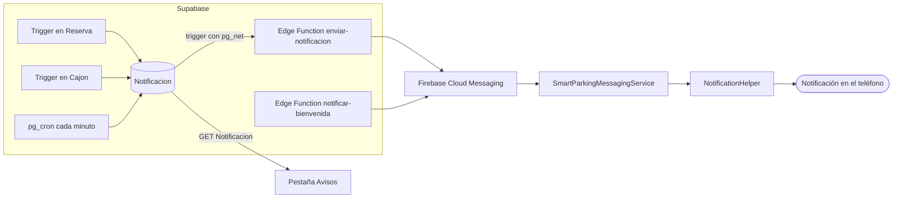
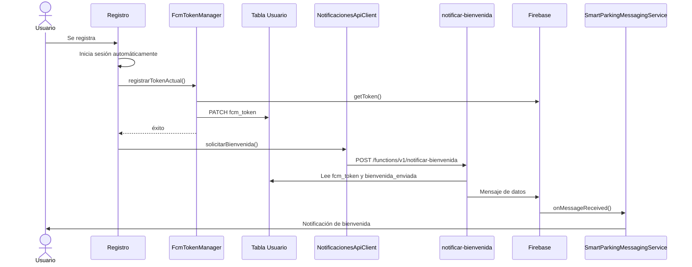

# Notificaciones push

Las notificaciones usan **Firebase Cloud Messaging (FCM)**. La app solo **recibe y muestra**; quien decide cuándo avisar y manda el mensaje es Supabase (triggers, `pg_cron` y Edge Functions). El detalle del lado del servidor (SQL, Edge Functions, secretos y despliegue) está en [Notificaciones en Supabase](Notificaciones%20en%20Supabase.md).

## 1. Qué avisa la app

| Tipo | Cuándo se envía | Origen | Se guarda en Avisos |
|---|---|---|---|
| `bienvenida` | Al crear una cuenta nueva | Edge Function `notificar-bienvenida` | No |
| `reserva_confirmada` | El pago se completó y la reserva pasa a confirmada | Trigger en `Reserva` | Sí |
| `reserva_extendida` | Se pagó una extensión y `tiempo_fin` aumenta | Trigger en `Reserva` | Sí |
| `recordatorio_fin` | Faltan 15 minutos o menos para `tiempo_fin` | `pg_cron` (cada minuto) | Sí |
| `cajon_reservado` | Empieza la reserva y el cajón pasa a *reservado* | Trigger en `Cajon` | Sí |
| `cajon_ocupado` | El sensor detecta un vehículo en el cajón reservado | Trigger en `Cajon` | Sí |
| `cajon_desocupado` | El vehículo sale y el cajón vuelve a *reservado* | Trigger en `Cajon` | Sí |

Los avisos de cajón y de fin de tiempo solo aplican a reservas **confirmadas y en curso**. Los textos exactos de cada tipo están en la [sección 4 del documento de Supabase](Notificaciones%20en%20Supabase.md).

## 2. Arquitectura



- **Los eventos no llaman a Firebase directamente.** Cada evento inserta una fila en `Notificacion`; un solo trigger manda cada fila nueva a `enviar-notificacion`. Así la tabla sirve a la vez de bandeja de salida y de historial para la pestaña Avisos.
- **La bienvenida va por separado:** la app la pide a la Edge Function justo después del registro y no se guarda en `Notificacion`.
- **La cuenta de servicio de Firebase nunca está en la app.** Solo vive como secreto de las Edge Functions.

## 3. Archivos

### Android (`com.smartparking`)

| Archivo | Responsabilidad |
|---|---|
| `notificaciones/SmartParkingMessagingService.java` | Recibe el token nuevo (`onNewToken`) y los mensajes (`onMessageReceived`) |
| `notificaciones/FcmTokenManager.java` | Guarda el token en `Usuario.fcm_token` y lo borra al cerrar sesión |
| `notificaciones/NotificationHelper.java` | Crea el canal y muestra la notificación |
| `notificaciones/NotificacionesApiClient.java` | Pide la bienvenida y lee el historial de avisos |
| `notificaciones/Notificacion.java` | Modelo de una fila de `Notificacion` |
| `ui/notifications/NotificationsFragment.java` | Pestaña Avisos |
| `ui/notifications/NotificationsViewModel.java` | Estado de la pestaña: lista, carga y error |
| `ui/notifications/NotificacionesAdapter.java` | Lista de avisos |
| `res/layout/fragment_notifications.xml`, `item_notificacion.xml` | Pantalla y fila de la lista |
| `res/drawable/ic_stat_sp.xml` | Ícono de la notificación (derivado de `branding/icono_SP.svg`) |

### Archivos existentes que cambiaron

| Archivo | Cambio |
|---|---|
| `Registro.java` | Tras el auto-login guarda el token y pide la bienvenida |
| `MainActivity.java` | Pide el permiso `POST_NOTIFICATIONS`, refresca el token y abre la pestaña Avisos cuando llega `navigate_to = "notifications"` |
| `SmartParkingApp.java` | Crea el canal de notificaciones |
| `ProfileViewModel.java` | `cerrarSesion()` llama a `FcmTokenManager.limpiarTokenAlCerrarSesion()` antes de borrar la sesión |
| `AndroidManifest.xml` | Permiso, servicio de FCM y metadatos de ícono, color y canal por defecto |
| `build.gradle.kts` (raíz y app), `libs.versions.toml` | Plugin `google-services`, BoM de Firebase y `firebase-messaging` |

## 4. Configuración del proyecto Android

| Elemento | Valor |
|---|---|
| Plugin | `com.google.gms.google-services` 4.5.0, declarado con `apply false` en `build.gradle.kts` de la raíz y aplicado en el del módulo `app` |
| Dependencias | `platform("com.google.firebase:firebase-bom:35.1.0")` y `firebase-messaging` (sin versión, la fija el BoM) |
| `google-services.json` | En `app/`. Está en `.gitignore`: cada integrante lo descarga de la consola de Firebase. El `package_name` debe ser `com.smartparking` |
| Permiso | `POST_NOTIFICATIONS` (Android 13+ lo pide en tiempo de ejecución desde `MainActivity`) |
| Canal | `reservas`, importancia alta, creado en `SmartParkingApp` |
| Servicio | `.notificaciones.SmartParkingMessagingService` con el filtro `com.google.firebase.MESSAGING_EVENT` |
| Ícono y color | `ic_stat_sp` y `sp_primary_blue` |

> El ícono de una notificación solo usa la **transparencia** de la imagen (Android lo pinta de blanco en la barra de estado). Por eso `ic_stat_sp.xml` no usa el fondo azul del SVG: el cuadro redondeado es la parte visible y las letras "SP" son huecos.

## 5. Token del dispositivo

El servidor necesita saber a qué teléfono mandar cada aviso. El token de FCM se guarda en `Usuario.fcm_token`.

| Momento | Qué pasa | Dónde |
|---|---|---|
| Registro (tras el auto-login) | Obtiene y guarda el token; cuando termina, pide la bienvenida | `Registro` → `FcmTokenManager.registrarTokenActual()` |
| Cada vez que se abre `MainActivity` con sesión | Vuelve a guardar el token (puede cambiar entre sesiones) | `MainActivity` |
| FCM entrega un token nuevo | Lo guarda si hay sesión | `SmartParkingMessagingService.onNewToken()` |
| Cerrar sesión | Pone `fcm_token` en `null` y pide al teléfono un token nuevo | `ProfileViewModel.cerrarSesion()` → `FcmTokenManager.limpiarTokenAlCerrarSesion()` |
| FCM responde que el token ya no existe | La Edge Function lo pone en `null` | `enviar-notificacion` y `notificar-bienvenida` |

Al cerrar sesión se pide un token nuevo para que quien inicie sesión después en el mismo teléfono no reciba los avisos del usuario anterior. La petición que borra el token manda el `Authorization` explícito, porque la sesión local se borra enseguida.



## 6. Cómo se recibe y se muestra

El servidor manda mensajes **solo de datos** (sin bloque `notification`). Así `onMessageReceived` se ejecuta siempre, con la app abierta o en segundo plano, y la notificación se ve igual en los dos casos.

| Campo | Contenido |
|---|---|
| `tipo` | Tipo del aviso (tabla de la sección 1) |
| `titulo` | Título de la notificación |
| `mensaje` | Texto de la notificación |
| `id_notificacion` | Id de la fila en `Notificacion` (no viene en la bienvenida) |

`NotificationHelper.mostrar()`:

- Revisa el permiso `POST_NOTIFICATIONS` en Android 13+. Sin permiso no muestra nada y deja un aviso en el log.
- Usa el canal `reservas`, el ícono `ic_stat_sp` y el color `sp_primary_blue` (se ve en el panel; la barra de estado siempre es blanca).
- Al tocar la notificación abre `MainActivity` con `navigate_to = "notifications"`, que lleva a la pestaña Avisos.
- Cada notificación usa un id distinto, así no se reemplazan entre sí.

## 7. Pestaña Avisos

`NotificationsFragment` muestra el historial del usuario: los avisos de la tabla `Notificacion`, del más reciente al más antiguo.

```
GET /rest/v1/Notificacion
    ?id_usuario=eq.<uuid>
    &select=id,id_reserva,tipo,titulo,mensaje,leida,created_at
    &order=created_at.desc
```

La política RLS limita las filas al usuario del token; el filtro por `id_usuario` es adicional.

| Estado | Qué se ve |
|---|---|
| Primera carga | Indicador de progreso |
| Sin avisos | "No tienes avisos todavía" |
| Error | El mensaje del error (por ejemplo "Error de conexión") |
| Con avisos | Lista de tarjetas. Las recargas son silenciosas |

- **Recarga:** cada vez que la pestaña se hace visible (`onResume`), así aparecen los avisos nuevos.
- **Fecha:** se muestra en hora local (`America/Mexico_City`) con `DateTimeUtils.formatearFechaHoraLocal()`, igual que el Historial de pagos.
- **Color del ícono por tipo:** verde para pagos (`reserva_confirmada`, `reserva_extendida`), naranja para `recordatorio_fin`, rojo para `cajon_ocupado` y azul de la marca para el resto.

## 8. Pruebas en la app

| # | Prueba | Cómo | Resultado esperado |
|---|---|---|---|
| 1 | Permiso | Abrir la app con sesión en Android 13+ | Aparece el diálogo de notificaciones |
| 2 | Token guardado | Iniciar sesión y consultar `Usuario.fcm_token` | No es `null` |
| 3 | Bienvenida | Registrar un usuario nuevo y aceptar el permiso | Llega "¡Bienvenido a SmartParking!" |
| 4 | App en segundo plano | Generar un aviso con la app cerrada | La notificación se ve igual que con la app abierta |
| 5 | Tocar la notificación | Tocarla | Se abre la app en la pestaña Avisos |
| 6 | Historial | Generar un aviso y abrir Avisos | Aparece al inicio de la lista con su hora local |
| 7 | Sin avisos | Entrar con un usuario sin filas en `Notificacion` | "No tienes avisos todavía" |
| 8 | Cerrar sesión | Cerrar sesión y consultar `Usuario.fcm_token` | Es `null` |
| 9 | Sin permiso | Denegar el permiso y generar un aviso | No se muestra la notificación, pero el aviso sí aparece en Avisos |

Las pruebas de triggers, recordatorios y Edge Functions están en [Notificaciones en Supabase](Notificaciones%20en%20Supabase.md).

## Pendiente

- **Marcar como leídos:** la columna `leida` existe pero no se usa. Falta una política `UPDATE` en `Notificacion`, marcar al abrir Avisos y un indicador de no leídos en la barra inferior.
- **La bienvenida no aparece en Avisos:** `notificar-bienvenida` manda el push directo sin insertar en `Notificacion`. Podría insertar la fila y dejar que el webhook la mande, para tener un solo camino.
- **Avisos sin actualización en vivo:** si llega un aviso con la pestaña abierta, la lista se actualiza hasta la siguiente recarga. Se puede resolver con Supabase Realtime.
- **Sin límite ni paginación:** la consulta trae todos los avisos del usuario.
- **Permiso denegado:** la app no vuelve a pedirlo ni ofrece abrir los ajustes del sistema.
- **Cambio de correo:** `EditarDatosPersonales` cierra la sesión sin borrar el token, así que ese teléfono puede recibir avisos hasta que el usuario vuelva a iniciar sesión.
- **Reserva pendiente que expira:** no genera aviso.
