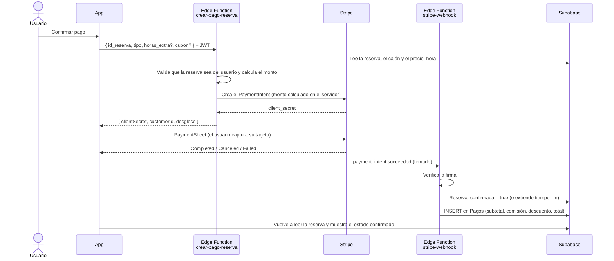

# Configuración de Stripe y flujo de pago

Los pagos usan **Stripe en modo prueba** con el componente **PaymentSheet** de Android. Stripe guarda los datos de la tarjeta: ni la app ni la base de datos los reciben.

## 1. Configuración

| Elemento | Dónde vive | Notas |
|---|---|---|
| Publishable key (`pk_test_…`) | `local.properties` → `BuildConfig.STRIPE_PUBLISHABLE_KEY` | Se inicializa una vez en `SmartParkingApp`. No está en el código. |
| Secret key (`sk_test_…`) | Secreto de las Edge Functions (`STRIPE_SECRET_KEY`) | Nunca en la app ni en el repo |
| Webhook secret (`whsec_…`) | Secreto de las Edge Functions (`STRIPE_WEBHOOK_SECRET`) | Para verificar que el evento viene de Stripe |
| Moneda | MXN | |

Configurar los secretos:

```bash
supabase secrets set STRIPE_SECRET_KEY=sk_test_... STRIPE_WEBHOOK_SECRET=whsec_...
```

Registrar el webhook en **Stripe → Developers → Webhooks**:

- URL: `https://kjbmwwbzdsvunzndeusf.supabase.co/functions/v1/stripe-webhook`
- Eventos: `payment_intent.succeeded` y `payment_intent.payment_failed`

## 2. Flujo de pago (objetivo)



### Por qué el webhook confirma y no la app

- Si la app se cierra justo después de pagar, la reserva igual queda confirmada.
- Nadie puede confirmar una reserva sin pagar llamando a la API directamente (lo impide la política RLS del issue 8.2).
- Stripe reintenta el webhook si falla, así que el pago siempre queda registrado.

## 3. Estado actual vs. objetivo

| Paso | Hoy | Objetivo |
|---|---|---|
| Cálculo del monto | La app calcula el total y lo manda a `crear-pago-reserva` | La Edge Function lo calcula con los datos de la BD (issue 12.2) |
| Confirmar la reserva | La app hace `PATCH confirmada = true` al recibir `Completed` | El webhook la confirma |
| Extender la reserva | La app hace `PATCH tiempo_fin` después de pagar | El webhook extiende `tiempo_fin` |
| Registro en `Pagos` | Lo hace el backend, pero solo con `monto_total` (`subtotal` está vacío en los 56 pagos actuales) | El webhook guarda subtotal, comisión, descuento y total |
| Publishable key | En `BuildConfig` | — |

## 4. Implementación de referencia

Incluida en `supabase/functions/` (propuesta para reemplazar las funciones actuales, que no se pudieron descargar del proyecto):

| Archivo | Qué hace |
|---|---|
| `crear-pago-reserva/index.ts` | Valida al usuario y la reserva, calcula el desglose, crea el PaymentIntent y lo regresa a la app. Con `solo_cotizar: true` solo regresa el desglose. |
| `stripe-webhook/index.ts` | Verifica la firma de Stripe, confirma o extiende la reserva y registra el pago. Si el evento llega dos veces, no duplica el pago. |
| `_shared/calculo.ts` | Fórmula de la comisión (issue 12.1), compartida por ambas funciones. |

Requiere la migración `20261018_pagos_desglose.sql`, que agrega a `Pagos` las columnas `comision`, `descuento`, `tipo` y `stripe_payment_intent`.

Desplegar:

```bash
supabase functions deploy crear-pago-reserva
supabase functions deploy stripe-webhook --no-verify-jwt   # Stripe no manda JWT
```

## 5. Cambios en la app

| Archivo | Cambio |
|---|---|
| `ReservaApiClient` | Mandar `{ id_reserva, tipo, horas_extra, cupon }` en lugar de `monto` |
| `ShoppingCartFragment` | Mostrar el desglose que regresa el servidor; al recibir `Completed`, ya no confirmar la reserva, solo volver a leerla |
| `HomeFragment` | Igual para la extensión: no hacer `PATCH tiempo_fin` |

## 6. Tarjetas de prueba

| Número | Resultado |
|---|---|
| `4242 4242 4242 4242` | Pago exitoso |
| `4000 0000 0000 0002` | Tarjeta rechazada |
| `4000 0000 0000 9995` | Fondos insuficientes |
| `4000 0025 0000 3155` | Pide autenticación 3D Secure |

Cualquier fecha futura y cualquier CVC de 3 dígitos.
