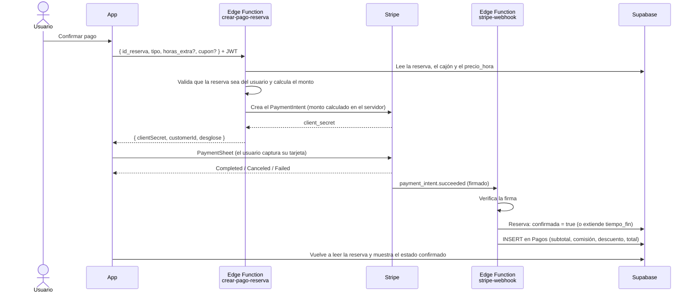

# Configuración de Stripe y flujo de pago

Los pagos usan **Stripe en modo prueba** con el componente **PaymentSheet** de Android. Stripe guarda los datos de la tarjeta: ni la app ni la base de datos los reciben.

Las tarjetas guardadas del usuario (Perfil → Métodos de pago) y cómo se muestran al pagar están en [Métodos de pago](Metodos%20de%20pago.md).

## 1. Configuración

| Elemento | Dónde vive | Notas |
|---|---|---|
| Publishable key (`pk_test_…`) | `local.properties` → `BuildConfig.STRIPE_PUBLISHABLE_KEY` | Se inicializa una vez en `SmartParkingApp`. No está en el código. |
| Secret key (`sk_test_…`) | Secreto de las Edge Functions (`STRIPE_SECRET_KEY`) | Nunca en la app ni en el repo |
| Webhook secret (`whsec_…`) | Secreto de las Edge Functions (`STRIPE_WEBHOOK_SECRET`) | Para verificar que el evento viene de Stripe |
| Moneda | MXN | |

Configurar los secretos:

```bash
supabase secrets set STRIPE_SECRET_KEY=sk_test_... STRIPE_WEBHOOK_SECRET=whsec_...
```

Registrar el webhook en **Stripe → Developers → Webhooks**:

- URL: `https://kjbmwwbzdsvunzndeusf.supabase.co/functions/v1/stripe-webhook`
- Eventos: `payment_intent.succeeded` y `payment_intent.payment_failed`

## 2. Flujo de pago (objetivo)



### Por qué el webhook confirma y no la app

- Si la app se cierra justo después de pagar, la reserva igual queda confirmada.
- Nadie puede confirmar una reserva sin pagar llamando a la API directamente (lo impide la política RLS del issue 8.2).
- Stripe reintenta el webhook si falla, así que el pago siempre queda registrado.

## 3. Estado actual

| Paso | Estado (07/11/2026) | Pendiente |
|---|---|---|
| Cálculo del monto y cupón | Hecho. La app manda `{ id_reserva, tipo, horas_extra, cupon }` a `crear-pago-reserva-v2`, que calcula el total y valida el cupón. La app ya no tiene porcentajes ni cupones | — |
| Desglose en pantalla | Hecho. El Carrito y el diálogo de extensión piden el desglose con `solo_cotizar: true` | — |
| Extender la reserva | Hecho. El webhook extiende `tiempo_fin`; la app ya no hace el `PATCH`, solo actualiza la reserva guardada en el teléfono | — |
| Confirmar la reserva | El webhook la confirma. La app todavía hace `PATCH confirmada = true` al recibir `Completed` (es el mismo valor, no causa problemas) | Quitarlo de la app antes de aplicar `rls_etapa2` |
| Registro en `Pagos` | Hecho. El webhook guarda subtotal, comisión, descuento, tipo y el id del PaymentIntent | — |
| Publishable key | En `BuildConfig` | — |

## 4. Edge Functions

En `/software/supabase/functions/`:

| Función | Qué hace |
|---|---|
| `crear-pago-reserva-v2/index.ts` | Valida al usuario y la reserva, calcula el desglose, crea el PaymentIntent y lo regresa a la app. Con `solo_cotizar: true` solo regresa el desglose. La fórmula de la comisión (issue 12.1) está en el mismo archivo. |
| `stripe-webhook/index.ts` | Verifica la firma de Stripe, confirma o extiende la reserva y registra el pago. Si el evento llega dos veces, no duplica el pago. |

Requiere la migración `20261018_pagos_desglose.sql` (ya aplicada), que agrega a `Pagos` las columnas `comision`, `descuento`, `tipo` y `stripe_payment_intent`.

Desplegar:

```bash
supabase functions deploy crear-pago-reserva-v2
supabase functions deploy stripe-webhook --no-verify-jwt   # Stripe no manda JWT
```

La función anterior `crear-pago-reserva` (recibe el monto desde la app) sigue desplegada para las instalaciones viejas de la app; se puede eliminar cuando todos usen la versión nueva.

## 5. Cambios en la app

| Archivo | Cambio |
|---|---|
| `ReservaApiClient` | Llama a `crear-pago-reserva-v2` con `{ id_reserva, tipo, horas_extra, cupon }`; `cotizar()` pide solo el desglose |
| `DesglosePago` | Desglose que regresa el servidor (subtotal, comisión, cupón, descuento y total) |
| `ShoppingCartFragment` | Muestra el desglose del servidor y valida el cupón con el servidor |
| `HomeFragment` | El diálogo de extensión muestra el desglose del servidor; después de pagar ya no hace `PATCH tiempo_fin` |

## 6. Tarjetas de prueba

| Número | Resultado |
|---|---|
| `4242 4242 4242 4242` | Pago exitoso |
| `4000 0000 0000 0002` | Tarjeta rechazada |
| `4000 0000 0000 9995` | Fondos insuficientes |
| `4000 0025 0000 3155` | Pide autenticación 3D Secure |

Cualquier fecha futura y cualquier CVC de 3 dígitos.
