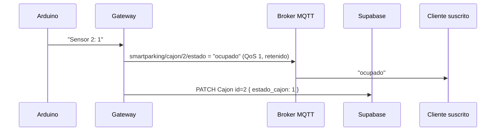

# Formato y estándares de comunicación

El sistema tiene dos canales: **serial** entre el Arduino y la Raspberry Pi, y **MQTT** entre la Raspberry Pi y los clientes. Este documento define el formato de ambos.

## 1. Mensajes MQTT

### Estado de un cajón

| Campo | Valor |
|---|---|
| **Tópico** | `smartparking/cajon/<id>/estado` |
| **Mensaje** | Texto plano: `libre`, `ocupado` o `reservado` |
| **QoS** | 1 |
| **Retenido** | Sí |
| **Cuándo se publica** | Solo cuando el estado del cajón cambia |

Ejemplos válidos:

```
smartparking/cajon/1/estado   libre
smartparking/cajon/2/estado   ocupado
smartparking/cajon/3/estado   reservado
```

### Estado del gateway

| Campo | Valor |
|---|---|
| **Tópico** | `smartparking/gateway/estado` |
| **Mensaje** | `online` u `offline` |
| **QoS** | 1 |
| **Retenido** | Sí |
| **Cuándo se publica** | `online` al conectarse; `offline` al detenerse o, si se cae, lo publica el broker (*Last Will*) |

### Equivalencia de estados

| Arduino (serial) | MQTT | Supabase (`estado_cajon`) | LED |
|---|---|---|---|
| `0` | `libre` | `0` | Verde (azul en discapacidad) |
| `1` | `ocupado` | `1` | Rojo |
| `2` | `reservado` | `2` | Amarillo |

## 2. Decisiones

### Texto plano en lugar de JSON

- El **tópico ya identifica el cajón**, así que el mensaje solo necesita el estado.
- Un cliente puede mostrar el estado sin parsear nada, y se lee fácil en `mosquitto_sub` durante las pruebas.
- El broker y Supabase ya guardan la hora: Mosquitto registra cuándo llegó cada mensaje y Supabase guarda el estado vigente. Un `timestamp` en el mensaje solo duplicaría ese dato.

Si más adelante se necesitan más datos (por ejemplo, la distancia medida), se puede cambiar a JSON sin cambiar los tópicos:

```json
{ "id_cajon": 2, "estado": "ocupado", "codigo": 1, "timestamp": "2026-10-18T18:30:05Z" }
```

### QoS 1

| QoS | Garantía | Decisión |
|---|---|---|
| 0 | Se envía una vez; puede perderse | Un cambio perdido dejaría el estado incorrecto hasta el siguiente cambio |
| **1** | **Llega al menos una vez** | No se pierden cambios; un duplicado no causa problemas porque el estado es el mismo |
| 2 | Llega exactamente una vez | Más lento (4 mensajes por envío) y no aporta nada, porque recibir dos veces "ocupado" no cambia nada |

### Mensajes retenidos

El broker guarda el **último** mensaje de cada tópico. Así, un cliente que se conecta ve de inmediato el estado actual de los 3 cajones, sin esperar a que alguno cambie.

### Last Will (`offline`)

Si la Raspberry pierde la conexión de golpe, el broker publica `offline` en `smartparking/gateway/estado`. Así los clientes saben que los estados pueden estar desactualizados.

## 3. Protocolo serial (Arduino ↔ Raspberry Pi)

**9600 baudios, 8N1, líneas terminadas en `\r\n`.**

### Del Arduino a la Raspberry

```
Sensor <n>: <estado>
```

| Ejemplo | Significado |
|---|---|
| `Sensor 1: 0` | El cajón 1 está libre |
| `Sensor 2: 1` | El cajón 2 está ocupado |
| `Sensor 3: 2` | El cajón 3 está reservado |

Se envía al cambiar un estado y cada 2 s para todos los cajones. El gateway ignora las líneas que no tengan este formato.

### De la Raspberry al Arduino

| Comando | Significado |
|---|---|
| `R<n>` | Empieza una reserva en el cajón n |
| `C<n>` | Quien reservó escaneó su QR |
| `L<n>` | Termina la reserva del cajón n |
| `F<n>` | Envío periódico cada n segundos (1–5) |

## 4. Resumen de un cambio de estado


